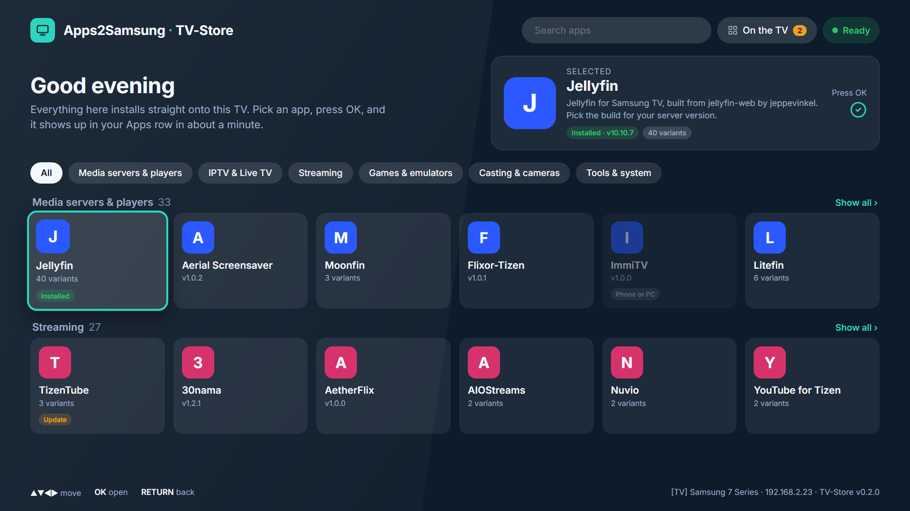
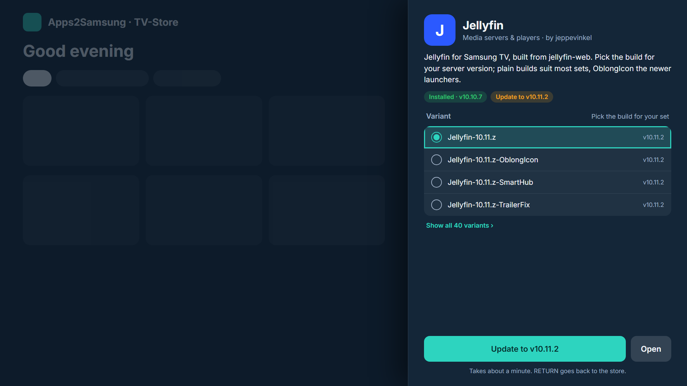
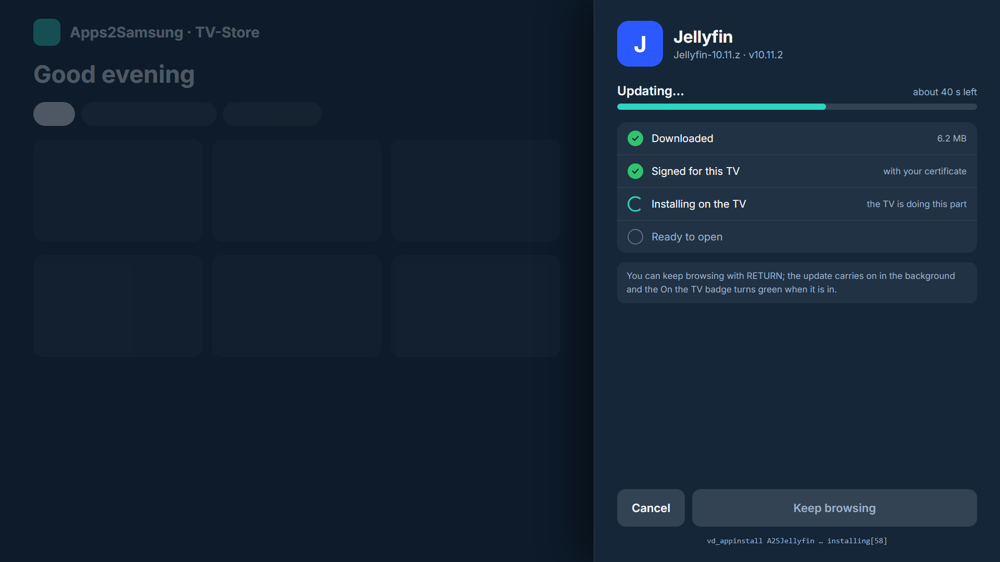
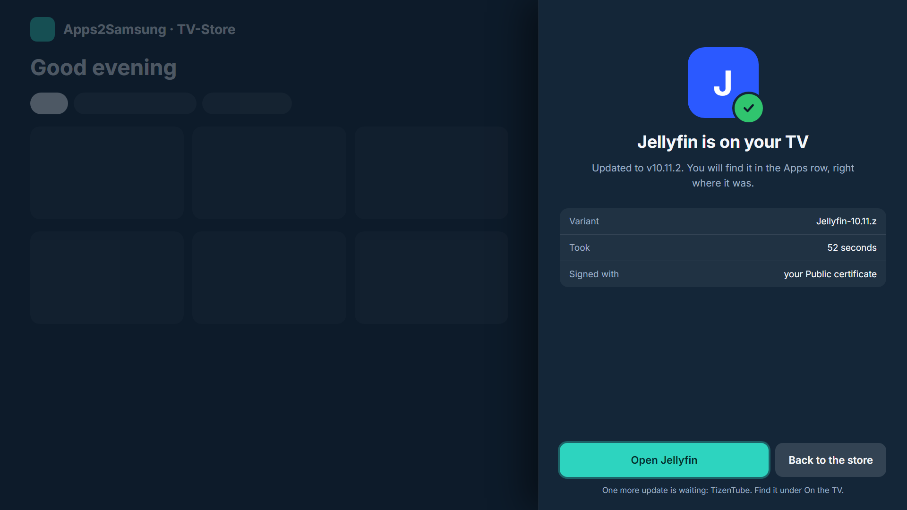
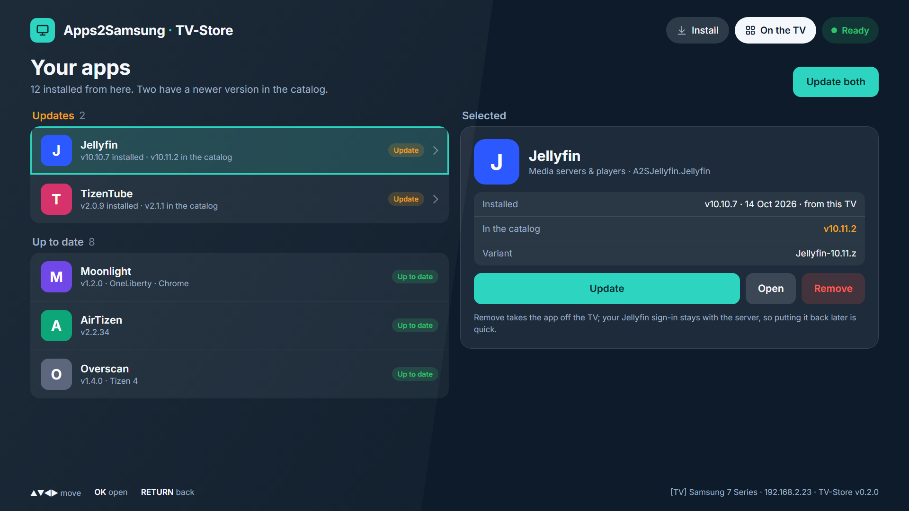
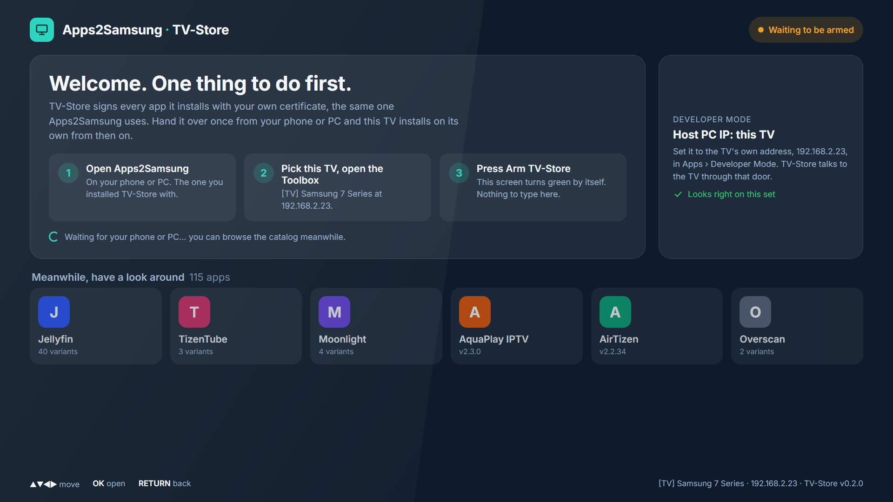

# Apps2Samsung TV-Store

The Apps2Samsung catalog on the TV itself. Browse with the remote, press OK, and the app installs
as a real Tizen package, straight into the Apps row. No PC or phone in the loop after a one-time
setup.



## How it looks

The screens below are the design the app is built towards. Dark glass, the Apps2Samsung category
colours, big tiles for a couch.

| | |
|---|---|
|  The app, its variants, one button. |  Download, sign, install: four steps you can watch or walk away from. |
|  Done, with Open right there. |  Your apps, updates first. |



## Requirements

- **Apps2Samsung 3.0 or newer** on a phone or PC, for the one-time arming. Until 3.0 is the stable
  release that means the [3.0 beta](https://github.com/Apps2Samsung/Apps2Samsung/releases); 2.x has
  no Arm TV-Store button.
- A Samsung TV in Developer Mode. Tested on Tizen 5.0 (2019) and Tizen 10 (2025); TV-Store asks for Tizen 3.0
  (2017) or newer.

## Setting it up

1. Install TV-Store from Apps2Samsung like any other app, with Developer Mode's **Host PC IP** set
   to your phone or PC as usual.
2. In Apps2Samsung, open the TV's **Toolbox** and press **Arm TV-Store**. That hands your signing
   certificate to the TV once. The TV-Store screen turns green by itself.
3. On the TV, set Developer Mode's **Host PC IP** to the TV's own address (TV-Store shows it).
4. Pick an app in TV-Store and press OK. It installs into the Apps row; no phone or PC needed from
   here on. Set Host PC IP back to your phone or PC whenever you want to use Apps2Samsung again.

## How it works

A Samsung TV only installs sideloaded packages through its developer connection (`sdbd`), the
same door Apps2Samsung uses from a PC. TV-Store is a web app with a small background service that
acts as the TV's own PC:

1. downloads the package from the catalog and checks it against the SHA-256 the catalog gives it,
2. signs it on the TV with your certificate (the same signatures Apps2Samsung makes),
3. pushes it to the TV's own `sdbd` and installs it.

The TVs cannot check today's HTTPS certificates (their certificate store is too old), so TV-Store
trusts the content instead: the catalog (`resolved.json.signed`) is signed by the Apps2Samsung
catalog workflow and checked against the key built into TV-Store, and a package installs only when
its hash matches that catalog.

For that, Developer Mode's **Host PC IP** on the TV must be set to the TV's own address.

The screen talks to the service over HTTP on port 8077. Apps2Samsung writes the TV's own IP into
TV-Store when it installs it, because Tizen 10 may not let a page reach its service over
`127.0.0.1`; when that address stops answering, TV-Store tries the TV's current IP and loopback.
The service only answers the TV itself, except for its log.

## The log

The service keeps its log on the TV, with the previous run's next to it, so it survives a crash.
Open `http://<TV IP>:8077/log.txt` on a phone or PC in the same network, or scan the QR code under
**Settings** (also shown when the service does not start), and attach it to a bug report.
When a bug report asks for more detail, turn on **Verbose logging** in Settings first (see below).

Some catalog apps need settings written into the package before they install (a server address,
an API key). The TV cannot do that yet, so those are shown greyed with a "Phone or PC" badge and
install from Apps2Samsung on a phone or PC instead. The same goes for apps that need root, and for
any file the catalog has no hash for.

## Settings

Press **▲** at the top of the list to reach **Settings**. The switches are remembered on the TV:

- **Show adult (18+) apps**: off by default. Turning it on asks "I am 18 or older" first, as the
  phone app does; those apps then carry an 18+ badge.
- **Show apps that need a PC or phone**: on by default, so nobody thinks an app is missing; turn
  it off to keep the greyed "PC / phone" apps out of the list.
- **Verbose logging**: off by default. Adds much more detail to the log: the sdb traffic, HTTP
  requests, the TV's network addresses and how long each install step took. Turn it on for a bug
  report and off again afterwards.

The header counts what the switches hide ("12 apps · 3 hidden").

## Pins, search by developer

- **Pin** in the app sheet pins that build of the app (the variant picked in the list) to a
  **Pinned** row at the top of the store, remembered on the TV. A pinned card shows that build's
  own state: its version, "Installed", or "Update to v…" when the catalog has a newer one; OK
  opens the sheet on that build. **Unpin** takes it off again.
- Apps whose builds share one package id (all Litefin builds are `LitefinApp`) cannot be told
  apart by the TV. TV-Store remembers which file it installed itself; for an app installed from
  a phone or PC, pin the build you have and TV-Store treats that as the installed one, on the
  On the TV page and for updates.
- The search box also matches the developer's name, and "by *developer*" in the app sheet is a
  link: OK shows every app by them (as Apps2Samsung does on the phone and PC).
- On the TV page, **▶** from an app in the list goes to its panel on the right (Details or
  Update, Open) and **◀** comes back to the list.

## Layout

- `tizen-app/`: the package: `config.xml`, `index.html`, `js/app.js`, `icon.png`, `service/`
- `tizen-app/service/index.js`: the service: catalog, certificate, install pipeline. The `.wgt` carries
  `service/` as one file, bundled by `scripts/bundle-service.js` (Tizen 10 runs services in an embedded
  Node 20 and does not start split ones)
- `tizen-app/service/sdb.js`: the SDB client (connect, push, install)
- `tizen-app/service/signer.js`: the package signer
- `tizen-app/service/catalog.js` + `catalog-key.js`: the signed catalog check and its public key
- `tizen-app/service/compat.js`: buffers that work on the TV's Node 4.4.3
- `tizen-app/js/app.js`: the UI, and `window.A2SStore`, which Apps2Samsung calls to arm the TV
- `tizen-app/js/qrcode.js`: QR codes for the log address and the Ko-fi link ([qrcode-generator](https://github.com/kazuhikoarase/qrcode-generator) 1.4.4, MIT)
- `test/`: a fake `sdbd` plus signer and transport tests
- `docs/design/`: the screens above

## Tizen 9 and 10

Since 0.3.9 TV-Store runs on 2025+ sets (Tizen 9 and 10). Those sets start a web service through
the `Service` class of the `wrt:service` module, so TV-Store starts its service that way there and
as before on older sets.

Set Host PC IP the same way as on any other TV: the TV's own address (shown in TV-Store), not
`127.0.0.1`. With anything else the TV turns the install away, and TV-Store says so.

## Build, test, release

A `.wgt` is a zip of `tizen-app/`; no Tizen Studio needed.

```sh
scripts/build-wgt.sh        # -> dist/TV-Store.wgt
node test/run.js            # connect + push + install against a fake sdbd
node test/sign.test.js      # the signer, with a certificate chain
node --expose-gc test/stream-sign.test.js  # the file-to-file signer on a 24 MB package
node test/bundle.test.js    # the bundled service starts however the platform loads it
node test/catalog.test.js   # the signed catalog: signature, age, hashes
```

Install the `.wgt` with Apps2Samsung like any package. A `vX.Y.Z` tag (matching the version in
`config.xml`) publishes a GitHub release with `TV-Store.wgt` as its one asset.

## Status

| Piece | State |
|---|---|
| Install through the TV's own `sdbd` | proven on a retail set |
| Signing on the TV | done, identical output to the Apps2Samsung signer |
| Arming from Apps2Samsung (phone, PC, CLI) | done |
| The screens above | built (0.3.4) |
| First real install from the TV | done, 2019 Tizen 5.0 set (0.3.4) |
| Tizen 3.0 and 4.0 sets (2017, 2018) | untested |
| Tizen 10 sets (2025) | done, retail set (0.3.9) |
