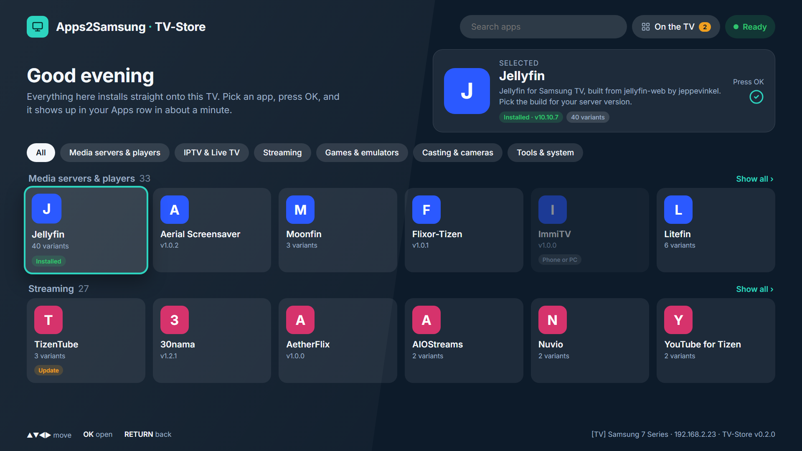
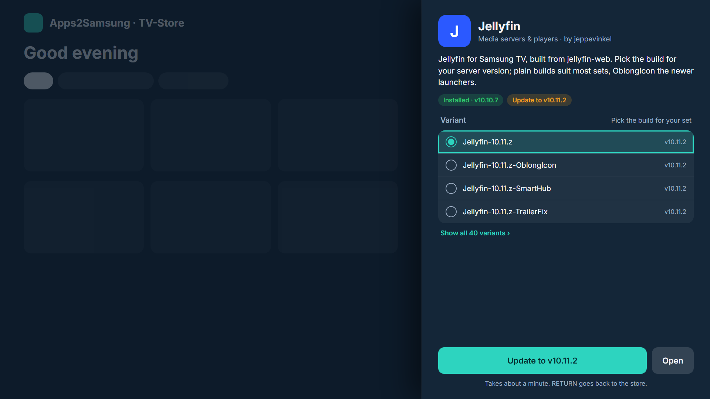
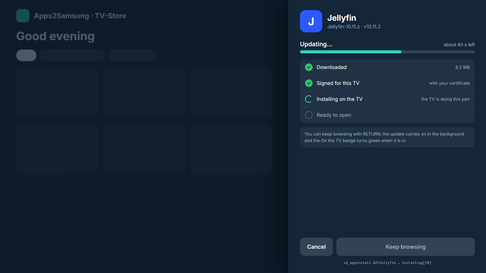
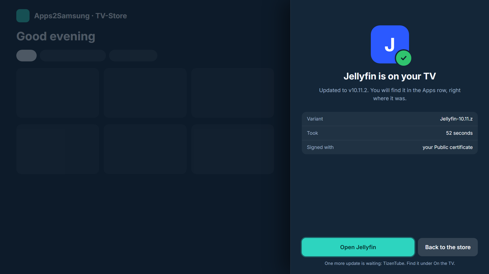
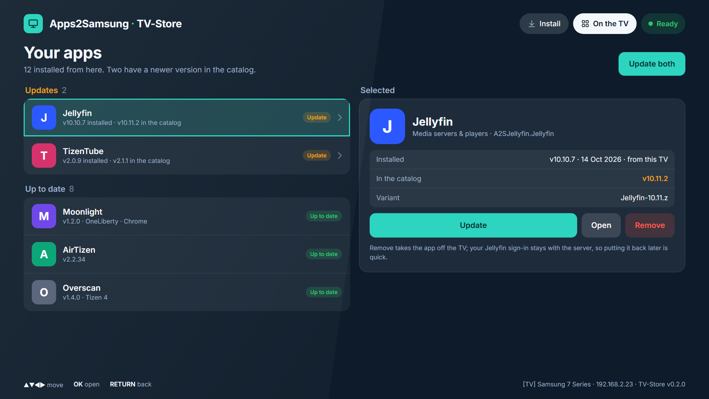
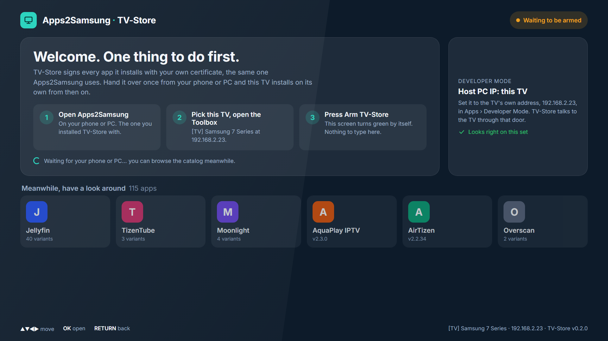

# Apps2Samsung TV-Store

The Apps2Samsung catalog on the TV itself. Browse with the remote, press OK, and the app installs
as a real Tizen package, straight into the Apps row. No PC or phone in the loop after a one-time
setup. Next to the official catalog, TV-Store also lists apps from signed
[independent repositories](#independent-repositories-sources) that you add in Apps2Samsung.



## How it looks

The screens below are the design the app is built towards. Dark glass, the Apps2Samsung category
colours, big tiles for a couch.

| | |
|---|---|
|  The app, its variants, one button. |  Download, sign, install: four steps you can watch or walk away from. |
|  Done, with Open right there. |  Your apps, updates first. |



## Requirements

- **Apps2Samsung 3.0 or newer** on a phone or PC, for the one-time arming. Until 3.0 is the stable
  release that means the [3.0 beta](https://github.com/Apps2Samsung/Apps2Samsung/releases); 2.x has
  no Arm TV-Store button.
- A Samsung TV in Developer Mode. Tested on Tizen 5.0 (2019) and Tizen 10 (2025); TV-Store asks for Tizen 3.0
  (2017) or newer. Every app in the catalog asks for its own Tizen version; one this TV is too old for
  shows a "Needs Tizen X" badge and does not install from here (the TV would refuse it with
  `install failed[118, -19]`, #44). Where the app has a build for older sets, the sheet lands on that one.

## Setting it up

1. Install TV-Store from Apps2Samsung like any other app, with Developer Mode's **Host PC IP** set
   to your phone or PC as usual.
2. In Apps2Samsung, open the TV's **Toolbox** and press **Arm TV-Store**. That hands every signing
   certificate on that phone or PC to the TV once. The TV-Store screen turns green by itself.
3. On the TV, set Developer Mode's **Host PC IP** to the TV's own address (TV-Store shows it), or
   to `127.0.0.1`. Either one works; `127.0.0.1` is what a rooted TV is pinned to.
4. Pick an app in TV-Store and press OK. It installs into the Apps row; no phone or PC needed from
   here on. To keep using Apps2Samsung from a phone or PC as well, turn on **Connect from Apps2Samsung** under Settings (below) instead of setting Host PC IP back.

## Apps installed from a phone or PC

Every install is signed with an author certificate, and a Samsung TV only updates an app with the
same author certificate it was installed with. Arming hands this TV every signing profile the phone
or PC holds (Public and Partner, the one older sets get, imported ones), and arming from a second
device adds its profiles to those. TV-Store remembers which profile each package took and, when the
TV answers `install failed[118, -12]` ("same id and different certificate"; `118012` on a 2018
set), signs again with the next profile until the TV takes one (#44). So an app installed from a
phone updates from TV-Store once that phone has armed the TV. Only when none of the profiles on the
TV matches does TV-Store offer to remove the old copy and install again; the app's settings and
sign-ins on the TV go with the old copy, which is why it asks first.

### Signing certificates in Settings

Settings lists every profile on the TV, one row each (#78): the name the phone or PC gave it, its
level (Public, Partner, or unknown, which is used as Public), the author fingerprint (the first 12
characters of its SHA-256, the same value the Apps2Samsung debug log prints, so the two can be
matched), how long it is valid (with a warning when it has run out or runs out within 30 days), and
whether its distributor certificate lists this TV's DUID. A profile that does not list this TV
cannot install here. OK on a row offers:

- **Use as default**: the profile tried first for an app that has none of its own yet. An app
  installed before still takes the profile it was installed with first, and an app that needs
  Partner still only takes a Partner one. A default chosen here stays the default when a phone or
  PC arms the TV again; without one, arming makes that device's first choice the default.
- **Remove**, after a confirmation: for a stale or expired profile that keeps being tried. Apps
  installed with it cannot be updated from TV-Store until a device arms the TV with it again.

## Public or Partner certificate

Apps2Samsung signs with a Public certificate unless an app needs a Partner one (partner-level rights
a Public certificate does not cover: a VPN, Samsung partner sign-in, killing other apps; or a hook
into a Samsung native package, as in SushyDev's YouTube for Tizen). A TV armed from a
device that has both profiles holds both, and TV-Store tells them apart by the Samsung CA that
issued the distributor certificate (the chain the phone or PC hands over), so a TV armed before
0.3.13 knows its levels too; Settings lists each certificate with its level (#50).

- An app the catalog marks `cert_level: partner` carries a **Partner certificate** badge and is
  signed Partner by itself. When the TV holds no Partner certificate its Install button is off and
  the sheet says how to get one: in Apps2Samsung, set the signing certificate to Partner and
  install any app once, so it creates one, then press Arm TV-Store again.
- Any other package whose manifest asks for a partner-level privilege (a VPN, Samsung partner
  sign-in, killing other apps) is signed Partner when the TV holds one, Public otherwise (those parts
  of the app then do not work). A file sent in from a browser gets the same, and its sheet says so.
  DRM playback and external storage are Public-level on a TV (Samsung lists AVPlay's DRM call as
  Public), so apps that only use those stay Public; should DRM still fail for one, **Sign with**
  below lets you pick Partner for it.
- When the TV holds both, the app sheet has **Sign with**: Automatic, Public or Partner, remembered
  per package.
- A package the TV already has keeps the certificate it was installed with, as above. Switching it
  from Public to Partner is a certificate mismatch, and the install screen offers to remove the old
  copy and install it again.

## How it works

A Samsung TV only installs sideloaded packages through its developer connection (`sdbd`), the
same door Apps2Samsung uses from a PC. TV-Store is a web app with a small background service that
acts as the TV's own PC:

1. downloads the package from the catalog (or from an [independent repository](#independent-repositories-sources)
   you added) and checks it against the SHA-256 that catalog gives it,
2. signs it on the TV with your certificate (the same signatures Apps2Samsung makes),
3. pushes it to the TV's own `sdbd` and has that install it (or, with the Settings switch **Try
   the TV's own installer** on, hands it to `wascmd` on the TV itself first, #57 below).

The TVs cannot check today's HTTPS certificates (their certificate store is too old), so TV-Store
trusts the content instead: the catalog (`resolved.json.signed`) is signed by the Apps2Samsung
catalog workflow and checked against the key built into TV-Store, and a package installs only when
its hash matches that catalog. While TV-Store stays open it reads the catalog again every ten
minutes, so a new app or version shows, and an app that left the catalog goes, without closing it.

App icons (#66) take the same road. The catalog names an icon per package file with its SHA-256
(`icon`, `icon_digest`, published by the Apps2Samsung catalog snapshot next to `resolved.json`),
the service fetches it, keeps it only when its bytes hash to that, caches it in its data folder and
serves it to the screen at `GET /icon/<sha256>`. The webview never fetches from apps2samsung.com
itself. An app without an icon in the catalog, or whose icon does not check out, keeps its letter
tile.

For the `sdbd` way, Developer Mode's **Host PC IP** on the TV must be set to the TV's own address
or to `127.0.0.1`. TV-Store tries both and uses whichever the TV lets in, so a rooted TV (pinned
at `127.0.0.1`) installs too.

**`wascmd` from the service (#57), off by default since 0.3.20.** `sdbd`'s `vd_appinstall` is itself a wrapper around
`/usr/bin/wascmd`, and TizenBrewInstaller runs that binary straight from its Node service, so the
Host PC IP never comes into it. From 0.3.16 to 0.3.19 TV-Store's service did the same first; since
0.3.20 only when the Settings switch **Try the TV's own installer (wascmd)** is on, because every
retail set tried so far has either refused the run or died starting it (next two paragraphs). With
the switch on: when
`/usr/bin/wascmd` is there and this Node can start a process (`child_process` on Tizen 3; the
binding it is built on, `process.binding('spawn_sync')`, on Tizen 4 and later, where the module is
stripped), the signed package goes to `wascmd -i <id> -p <file>` (arguments as a list, no shell)
and its reply is read exactly like `vd_appinstall`'s. When `wascmd` did not get to install (not
there, not allowed under the service's label, "cannot working in released image", nothing printed)
the install falls back to `sdbd` as before, and the log says so. The binding is synchronous, so
the service answers nothing while `wascmd` runs; the page's install call waits longer than that.
Right before the first install the log also gets what `wascmd` prints without arguments (its
flags; no document gives them, the uninstall one in particular), so a real set's log is where they
get read from. Until then, removing an old copy for a replace still goes over `sdbd`; when `sdbd`
cannot be reached while `wascmd` does the installs, the replace stops with `REPLACE_NEEDS_SDB` and
says what to do instead of running into the same certificate mismatch.

**What starting `wascmd` can cost (#67, #68).** On two Tizen 9 sets (2023 models on the 2025
firmware) 0.3.16 and 0.3.17 did not come up at all: the service ran `wascmd` without arguments at
start-up for its usage text, and that fork took the shared `wrt-service` process down on most
starts, before the service listened ("Launched, but nothing answers on port 8077"); on the starts
it survived, the TV refused the run with `EACCES`. So the service starts nothing before the first
install, and guards that in three ways. It asks the kernel first, without a fork, whether it may
run the binary at all (`access(2)` with `X_OK`, which the file's mode and the TV's Smack labels
both answer; the log says `this service may not run it: EACCES` and installs take `sdbd`). It
keeps a marker file (`.a2s-wascmd-running` in the data folder) from before the first process
starts until `wascmd` answered, so a service that finds it at the next start knows the last run
died inside that call, says so, keeps to `sdbd` and remembers that in `.a2s-installer.json`; a
spawn that fails outright (`EACCES`, `ENOENT`) is remembered the same way. And since 0.3.20 the
whole path is opt-in: the Settings switch **Try the TV's own installer (wascmd)** is off by default,
so every install goes through `sdbd` as before 0.3.16; turning it on hands installs to `wascmd`
first, and turning it off and on again forgets what the service learned, so `wascmd` gets one more
try. The choice is kept in `.a2s-installer.json` as `mode: 'auto'` with `optIn: true` (a file from
0.3.18 or 0.3.19 saying `auto` meant the default then and is not read as a choice).
`A2S_INSTALLER=sdb` or `auto` in the service's environment overrides it for a test. `/ping` reports it
(`installer: { mode, env, wascmd: { path, present, executable, denied, spawn, available }, off,
last }`), `POST /settings { installer: { mode: 'auto' | 'sdb' } }` flips it, and the log's second
line at start says which way installs will take.

**A Tizen 5.0 set (2019) says the same, one step further in (#57).** There `child_process` is present, `access(2)` allows the run, and the service hands the signed package to `wascmd`; that fork takes the service down before anything is installed, so no reply and no usage text ever reach the log. The next start finds the marker and keeps to `sdbd`. With that, every retail set tried (Tizen 5 and 9) has either refused `wascmd` or died starting it, which is why the switch above is off by default: `sdbd` over the TV's own address or `127.0.0.1` is the path that installs.

The screen talks to the service over HTTP on port 8077. Apps2Samsung writes the TV's own IP into
TV-Store when it installs it, because Tizen 10 may not let a page reach its service over
`127.0.0.1`; when that address stops answering, TV-Store tries the TV's current IP and loopback.
The service only answers the TV itself, except for its log.

## The log

The service keeps its log on the TV, with the previous run's next to it, so it survives a crash.
Open `http://<TV IP>:8077/log.txt` on a phone or PC in the same network, or scan the QR code under
**Settings** (also shown when the service does not start), and attach it to a bug report.
When a bug report asks for more detail, turn on **Verbose logging** in Settings first (see below).

Some catalog apps need settings written into the package before they install (a server address,
an API key). The TV cannot do that yet, so those are shown greyed with a "Phone or PC" badge and
install from Apps2Samsung on a phone or PC instead. The same goes for apps that need root, and for
any file the catalog has no hash for.

## Your own app (.wgt or .tpk)

Open `http://<TV IP>:8077/upload` on a phone or PC in the same network (Settings shows it as a QR
code), pick a `.wgt` or `.tpk` and send it. The TV keeps the file and TV-Store asks on screen:
who sent it, what the package calls itself, its hash, then **Install on this TV**, **Not now** or
**Discard**. Nothing installs until OK is pressed on the remote. The file is signed with your
certificate and installed like a catalog app, without the catalog's hash check (the file is yours).

One file waits at a time (a new one replaces it), at most 400 MB, and it must be a Tizen package
(a zip with `config.xml` or `tizen-manifest.xml` at its root). The upload page is open to the
network like the log; the install is not: only the TV-Store screen can start it, with a key the
service writes into the app's private data folder at every start, where no other app on the TV
can read it. The TV must be armed first.

If the TV already has a different app under the file's package id, the screen says so ("Already on
your TV: …"). A file sent this way has no catalog entry to derive another id from, so installing
it replaces that app.

## Browse and install from a phone or PC

Open `http://<TV IP>:8077/` on a phone or PC in the same network (Settings shows it as a QR code
while **Install from a browser** is on, which it is by default). The page shows the store as
TV-Store on the TV sees it: every app the Settings let through, with **Installed**, **Update to
vX**, the TV's model, Tizen version, certificates and free space, the install that is running and
what is queued after it. **Install**, **Update** and **Update all** there ask the TV-Store screen
to do it, and it installs exactly as if OK was pressed on the remote: the same build choice,
signing, checks and questions, a toast saying which phone or PC asked, and the progress on the TV
and on the page. Nothing is installed by the service on a browser's word alone.

So TV-Store has to be open on the TV; the page says when it is not. An app that cannot be installed
from there says why on the page: it needs Apps2Samsung on a phone or PC (user settings, root, an
injector, settings from an independent repository), a newer Tizen, a Partner certificate, the build on the TV is not known, or it came from
another source and switching needs a yes on the TV. Questions that come up during an install
(another app has the package id, another certificate installed it) are answered on the TV.

Who may use it: anyone on the network, like `/upload`, unless devices are picked under **Devices
that may connect** in Settings (the relay's allow list), which then holds here too. The page is served only under an IP address or a LAN name (not
a public name pointed at the TV), and an Install from another web site (its `Origin`) is refused.
The page loads nothing from outside the network.

How it works: the TV-Store screen sends what it shows to the service every 3 seconds
(`POST /store/state` with the page token; only the whole picture when it changed), a browser reads
`GET /store/state` and asks with `POST /store/install { key }` or `{ all: true }`, and the screen
takes the request in the answer to its next send and reports back with `POST /store/ack`.

### Apps with settings

Some apps need a value typed in before they install: a server address, an API key, a port (the
catalog's `user_settings`, the same form Apps2Samsung shows). On the browser page their button opens
a form; the values go to the service, are checked against the signed catalog (required, digits,
range, the field's pattern), kept on the TV and written into the package before it is signed,
exactly as Apps2Samsung writes them (`usersettings.js`: an exact-text replacement, every
occurrence, quotes escaped; a package whose text changed upstream is not installed). An update from
the TV writes the same values again, so Update and Update all keep working for these apps. **Change
its settings** on the page installs an app that is current again with the new values.

On the TV such an app's page shows a QR code that opens its form on a phone (`/#app=<key>`). Without
saved settings, an app with a required setting says it needs them first (`NEEDS_SETTINGS`), and an
app that is on the TV with settings typed on the phone or PC that installed it is not updated from
the TV (`SETTINGS_ELSEWHERE`): the update would drop them. Enter them on the page once, or update it
from Apps2Samsung. An app with only optional settings installs as published.

The values can be credentials: kept in TV-Store's private data folder (`.a2s-user-settings.json`,
mode 0600), never logged, never sent back to a browser; `/ping` and the page only say which fields
are saved, and a form leaves a saved field as it is when left empty. Only the official catalog's
apps get settings here; an independent repository's app with settings stays for a phone or PC.

## Opening TV-Store from another app

Another app on the TV can send people to TV-Store, for its own "Get apps" button for example. TV-Store's
app id is `A2STVStore.Store`.

- **Just open it:** `tizen.application.launch('A2STVStore.Store')`.
- **Open it on one app (#102):** launch it with an app control whose data has `app`: the catalog name
  (`Jellyfin`), or a package id or app id from the catalog. TV-Store opens that app's page once the
  catalog has loaded; the user decides there, nothing installs by itself. A name the catalog does not
  know opens the store as usual. If TV-Store is already open, it switches to that app's page, unless an
  install is running on screen.

```js
tizen.application.launchAppControl(
    new tizen.ApplicationControl('http://tizen.org/appcontrol/operation/default', null, null, null,
        [new tizen.ApplicationControlData('app', ['Jellyfin'])]),
    'A2STVStore.Store',
    function () { /* TV-Store is up */ },
    function (e) { /* not installed: point people to apps2samsung.com */ });
```

The key `app` stays; more keys may come. Tried on a 2019 Tizen 5.0 set: an app control with
`app=Jellyfin` opens TV-Store on Jellyfin's page (0.3.28). Not yet tried from Vetro itself.

## A fork that kept another app's package id

Forks often keep upstream's package id: tacplayer ships the official Jellyfin id `AprZAARz4r`.
Installing one used to replace the app with that id, and its data (#84). Now, before signing,
the service reads the package's `config.xml` id and `<name>`, and the page tells it which apps the
TV has (package id and names, from `tizen.application.getAppsInfo`):

- **Not on the TV, or the same name** (case and spaces aside): installs under its own id, as before.
  The same name means the same app, so updates and variants of one group are not renamed.
- **A different app has the id, `.wgt`:** installs as a separate app under an id of its own. The
  done screen says "Installed as a separate app, because Jellyfin already uses this id."
- **A different app has the id, `.tpk`:** native code can hardcode its own paths, so it is not
  renamed. The install stops with "Already on your TV: …", and the screen offers **Cancel** or
  **Replace it**.

**The new id is the same in every client** (Apps2Samsung#1028), so an app renamed by TV-Store is
found and updated by Apps2Samsung, and the other way round. It is the first 10 characters of
`base62(sha256("a2s-pkgid-v1:" + key))`, one character per byte (`byte % 62`, alphabet
`0-9A-Za-z`). The key names the catalog entry, so it does not change between versions:

| Where the file comes from | key |
|---|---|
| Official catalog, community package | the entry's `repo`, `/`, its `file`: `sfsdffesfsfg-cloud/tacplayer/tacplayer.wgt` → `ln9ooxgrYz` |
| Official catalog, provider of its own | `owner/name` from its GitHub releases URL, `/`, the asset's name: `jeppevinkel/jellyfin-tizen-builds/Jellyfin.wgt` → `NlEuwl5oL0` |
| Independent repository | the repository's URL (the `repository.json.signed` one it was added under), `/`, the asset's name |

The rewrite is what Apps2Samsung's `PackageIdRewriter` does. The old id is replaced as a whole
token in `config.xml` (the application id and package, and the service components' ids) and in
every text file of the package (`.js`, `.html`, `.json` and the like, for an app that launches its
own service by id). Signatures are dropped, and the package is then signed like every install.

Once renamed, updates land on that copy. The service finds it by the derived id, so a copy
Apps2Samsung renamed counts too, and another build of the same app goes to the same tile. Each
rename is kept in the data folder (`.a2s-package-renames.json`: original and new package and
application id, the key, the source). The page gets every catalog file's derived id from
`GET /pkgids`. With those, the Installed badge, the update check, Open and the certificate the app
was signed with all follow the renamed copy. The package's own id on the TV stays with the other app.

## Independent repositories (sources)

Developers can publish their own **signed repository** of Tizen apps, Cydia-style, without going
through the official catalog (#82, part of
[tizen-community-packages#208](https://github.com/Apps2Samsung/tizen-community-packages/issues/208)).
The format, the signature, the key fingerprint and the rules every client applies are specified in
[tizen-community-packages: docs/repositories.md](https://github.com/Apps2Samsung/tizen-community-packages/blob/main/docs/repositories.md),
with a ready-to-copy publisher template next to it. TV-Store lists those apps next to the official
catalog's and installs them the same way: downloaded, checked against their hash, signed with your
own certificate, installed.

### Adding one

You add a repository in **Apps2Samsung** on a phone or PC, which shows its name, address and key
fingerprint and asks you to approve them (Apps2Samsung#1018). Then, in the TV's **Toolbox**, **Send
sources to TV** hands the approved repositories to TV-Store, over the same connection arming uses.
TV-Store checks each one and asks on screen before it keeps it: name, maintainer, address, how many
apps, and the full key fingerprint (64 hex characters, compare it with what Apps2Samsung showed),
then **Add source** or **Don't add**. A source that does not check out is shown with why, and only
**Close** is offered.

There is no way to type a repository address on the TV. The TV cannot validate HTTPS, so it has no
safe way to decide on a key by itself: a key fetched over an unchecked connection could be anyone's.
So what the TV trusts is the **fingerprint**, and a fingerprint reaches the TV only from somewhere
that vouches for it: Apps2Samsung, where the user approved it, or the signed official catalog (a
moved app, below). The key itself may come along (`publicKeyPem`); when it does not, the service
fetches `repository.pem` next to the manifest and keeps it only when its SHA-256 is that
fingerprint, which no swapped file can be. Either way the key is pinned on the TV from then on.
Fetching is the normal path, since the official catalog's `moved_to` carries a fingerprint and no
key. A publisher
who changes keys needs a new approval in Apps2Samsung and a new **Send sources to TV**; until then
the source stops loading, because its signature no longer matches the pinned key, and Settings says
so.

### What the TV checks

Every time it loads a repository (cached for 10 minutes, like the official catalog), the service
refuses it whole when any rule of the spec fails, with the spec's reason code in the log and in
Settings: larger than 8 MiB (`size`); no signature line (`no-signature`); a key that is not RSA or
has fewer than 3072 bits (`key`); a key other than the approved one (`fingerprint`); a bad signature
(`signature`); not JSON (`json`); a `schemaVersion` this TV-Store does not know (`schema-version`);
anything the schema does not allow, such as an `http://` download, a bad `digest`, or an icon
without `icon_digest` (`schema`); a URL at an IP address, `localhost`, `*.local` or with a user
name in it (`url`); a manifest that calls itself another repository than the approved one
(`repository-id`); dated more than an hour ahead (`future`); more than 7 days old (`expired`);
older than the last one accepted from it (`rollback`); and two providers with the same id, or one
`package_id` and version from two providers (`duplicate`). The fetch itself gives up after 60
seconds, 5 redirects or 8 MiB. `test/repos.test.js` runs every test vector of the spec through
this.

A file installs only when its bytes hash to its `digest`, and an icon shows only when it hashes to
its `icon_digest`, exactly as for the official catalog. A repository's own signing certificate
plays no part: TV-Store signs every package with your certificate, as always.

### On the screen

- Once the TV has a source besides the official catalog, every card says where the app comes from
  (**Official** or the repository's name), the app sheet says "from …", and a **From** row of chips
  under the categories filters the store by source. Without sources nothing changes.
- An app from a repository says in its sheet that the repository's signature means the files come
  from its publisher, not that Apps2Samsung reviewed them.
- **An installed app belongs to the source it came from.** The service remembers that per package
  (`.a2s-source-by-package.json`; a package it has no record for counts as the official catalog's,
  as before). Its "Installed" and "Update" state, **On the TV** and **Update all** come only from
  that source. Updates never jump to whichever source has the newest version.
- **The same app from two sources** shows as two cards. The other source's card says the app on
  the TV came from elsewhere, and its button reads **Install from *repository* instead**: pressing
  it is the explicit choice that moves the app, and from then on its updates come from there. The
  service refuses such an install (`SOURCE_SWITCH`) without that choice, whatever asks for it.
- A source that does not load says why under **Settings, Sources** and drops out. The official
  catalog and the other sources carry on. Nothing installs from a source that did not verify.
- `required_version` and the "Needs Tizen X" badge, Partner certificates (`cert_level`), 18+
  (`adult`) and root apps (`flags: ["root"]`) work for repository apps as for official ones.

### A newer catalog format

The official catalog has a format version (`schemaVersion`, see
[Versioning](https://github.com/Apps2Samsung/tizen-community-packages/blob/main/docs/catalog.md#versioning)).
TV-Store knows version 1, both for the signed snapshot and for the community catalog inside it. When
either says a higher number, TV-Store keeps working with what it understands (the signature and every
file's hash are still checked) and shows a banner asking to update TV-Store from Apps2Samsung; the log
says `catalog: format version N`. A breaking change is announced 30 days ahead, so an up-to-date
TV-Store doesn't see it.

### Apps that moved out of the official catalog

When an app leaves the official catalog for its developer's own repository, its manifest in
tizen-community-packages gets `moved_to: { url, fingerprint }` for a notice period (see
[Moving an app out of the official catalog](https://github.com/Apps2Samsung/tizen-community-packages/blob/main/docs/repositories.md#moving-an-app-out-of-the-official-catalog)).
TV-Store reads it from the signed catalog:

- While such an app is on the TV and still updates from the official catalog, the store shows a
  banner: "*App* has moved to the developer's own repository at *domain*", with **Add source** and
  **Not now** (remembered per repository). The app sheet says the same with the same button, and On
  the TV points there.
- **Add source** opens the usual confirmation, marked "Named by the official catalog". The signed
  catalog vouches for the key here instead of an approval in Apps2Samsung, and the repository id is
  read from the manifest (`moved_to` carries none). The service checks that the URL and fingerprint
  are what the official catalog names for some package (`NOT_MOVED` otherwise).
- Once added, every installed app the official catalog says moved there, that the repository
  lists, and that came from the official catalog takes its updates from the repository from then
  on, without a reinstall. When the repository is on the TV already, the button reads **Take updates
  from there** and does only that.

### Settings, Sources

Settings lists **Official** (always there, cannot be removed) and every repository on the TV: its
name, maintainer, address, the start of its key fingerprint, and when it last verified (with its app
count) or why it does not load now. OK on a repository offers **Turn off** / **Turn on** (off: its
apps are not shown and nothing installs from it) and **Remove**, which asks first. A removed
repository's apps stay on the TV, but get no updates from anywhere until Apps2Samsung sends the
source again. Adding sources happens only through Apps2Samsung.

### For Apps2Samsung (Send sources to TV)

Over the web inspector, like arming (`A2SStore.setCertificate`):

```js
A2SStore.addSources([
  { url: 'https://owner.github.io/tizen/repository.json.signed',   // https, a public host name
    repositoryId: 'io.github.owner.tizen',                          // repository.id, pinned
    fingerprint: '<64 hex: SHA-256 of the DER public key>',         // as the user approved it
    name: "Owner's Tizen apps",                                     // optional, shown until checked
    publicKeyPem: '-----BEGIN PUBLIC KEY-----…' }                   // optional; must match the fingerprint (saves a fetch)
])
// -> Promise of { ok: true, results: [{ url, repositoryId, added: true|false, name?, error? }] }
```

The promise resolves once the person at the TV has answered every source (`added: false` with
`error: 'declined on the TV'`, or why the source did not check out). `A2SStore.status()` (the
service's `/ping`) lists the sources on the TV (`sources: [{ url, repositoryId, fingerprint, name,
maintainer, domain, enabled, lastGeneratedAt, lastOkAt, lastError, lastErrorReason, ok, apps }]`,
never the key) and where each installed package came from (`sourceOf: { packageId: 'official' |
repositoryId }`). Sending a source the TV already has again is fine: with the same key it is turned
on again and keeps its rollback state; with a new key the TV says the publisher changed keys.

The service's own routes, for this TV only: `GET /sources`, `GET /sources/catalog[?fresh=1]` (every
source with its verified manifest or its error), `POST /sources/check` (verify without keeping),
and `POST /sources/add`, `/sources/enable { repositoryId, enabled }`, `/sources/remove {
repositoryId }`, which need the page's token, like an upload, because every app on the TV can reach
port 8077. `POST /install` takes `source` (`official` when left out) and `switchSource: true`.
`POST /sources/check` and `/sources/add` take `{ url, fingerprint, moved: true }` without a
`repositoryId` for a source the official catalog names in `moved_to`; `/sources/add` then answers
which packages it moved over (`source.adopted`) and the new `sourceOf`. The
sources are kept in `.a2s-sources.json` in the service's data folder.

## Settings

Press **▲** at the top of the list to reach **Settings**. The switches are remembered on the TV:

- **Install from a browser**: on by default (#101). Lets a phone or PC open
  `http://<TV IP>:8077/` and install from there while TV-Store is open; see Browse and install from
  a phone or PC. Off, the page says so and refuses every Install.
- **Show adult (18+) apps**: off by default. Turning it on asks "I am 18 or older" first, as the
  phone app does; those apps then carry an 18+ badge.
- **Show apps that need a PC or phone**: on by default, so nobody thinks an app is missing; turn
  it off to keep the greyed "PC / phone" apps out of the list.
- **Verbose logging**: off by default. Adds much more detail to the log: the sdb traffic, HTTP
  requests, the TV's network addresses and how long each install step took. Turn it on for a bug
  report and off again afterwards.
- **Try the TV's own installer (wascmd)**: off by default (#57). On, an install is handed to
  `/usr/bin/wascmd` by the service itself before `sdbd` is tried; on every retail set so far that
  has taken the service down, so it is there for anyone who wants to report what their TV does.
- **Connect from Apps2Samsung (sdb relay)**: on by default when Host PC IP is `127.0.0.1`, off
  otherwise (#52; the default since 0.3.28). The service checks once at start, and at every install
  over loopback, whether `sdbd` takes a connection on `127.0.0.1`, which it only does with Host PC IP
  at `127.0.0.1`; then no phone or PC reaches `sdbd` any other way, so the relay turns itself on
  (`relay.auto` on `/ping` and `GET /relay` says why). Turned on that way it is not saved as on, so
  a TV whose Host PC IP changes back gets it off again after the restart. Once the switch is used,
  on or off, that choice stands (`relay.chosen`), and a relay setting saved by an older TV-Store
  counts as a choice too. The TV's `sdbd` lets a
  connection in only from the address Developer Mode's Host PC IP names, so with Host PC IP at
  `127.0.0.1` (what TV-Store and a rooted TV want) no phone or PC can reach it. With this on,
  TV-Store's service holds port 26201 open on the TV and hands every connection to `sdbd` over
  loopback; `sdbd` then sees `127.0.0.1` and accepts, whatever the client's address. Set Host PC
  IP to `127.0.0.1` once, restart the TV, and Apps2Samsung 3.2 or newer connects to the TV from
  any phone or PC by itself (it reads the Host PC IP from the TV and dials the relay instead of
  26101). The switch says the address. While it is on, any device in your network can install
  through that port, unless you pick devices below. This switch lives in the service, not in the
  page's settings, so `/ping` reports it (`relay: { enabled, listening, port, sessions, allow,
  seen, error, served, failures, lastFailure }`).
- **Devices that may connect**: the phones and PCs that connected since TV-Store started, through
  the relay or with a browser, each with a switch (`relay.seen` on `/ping`, the TV only). With none
  switched on, any device in your network can connect. With one or more on, only those can, for the
  relay and for the store in a browser alike; a device that was kept out is listed too, so it can
  be switched on. This is the relay's allow list (`POST /settings { relay: { allow: [...] } }`),
  made with the remote instead of typed. The choice is kept on the TV; the list of who came by is
  not.

  Vetro (a TV manager) runs a background service that starts with the TV and restarts itself
  (`on-boot`, `auto-restart`), whether or not the Vetro app is open. That service keeps its own
  connection to `sdbd` open and shares it through an sdb tunnel on `127.0.0.1:26201`, the port
  this relay uses too (#90). `sdbd` takes one client at a time, so with Vetro on the TV every
  direct connection is turned away and this switch cannot start ("Another app on this TV already
  uses port 26201"); closing the Vetro app does not free it. Vetro opens that connection once and
  keeps it, so it is never free for long. TV-Store then installs through Vetro's tunnel: after the
  TV's own IP and `127.0.0.1:26101` it tries `127.0.0.1:26201`, then the TV's own IP on 26201, and
  keeps to the one that worked for the next installs. On an S95F (Tizen 9) the TV keeps one app out
  of another app's port on loopback (`EHOSTUNREACH`), so the way in is the TV's own IP, which Vetro
  only lets in with its "Allow SDB from the local network" switch on (0.3.25). Without it the install
  stops with `APP_HOLDS_SDB` and says to turn that switch on, instead of blaming Host PC IP. A phone
  or PC reaches the TV through the same switch.

  The sdb protocol cannot tell a phone or PC why its connection died, so through a relay every
  failure looks like "connection reset" (#58). The relay therefore works out what happened to each
  connection and keeps the last failure with a reason in words: `sdbd` not listening
  (`SDBD_DOWN`: Developer Mode off, or the TV needs a restart), `sdbd` taking the connection and
  closing it without a byte back (`SDBD_DROPPED`: Host PC IP is not `127.0.0.1`, or the TV was not
  restarted after setting it), `sdbd` never answering before the client gave up (`SDBD_SILENT`),
  another socket error (`SDBD_ERROR`), the allow list (`NOT_ALLOWED`) or the session cap (`BUSY`).
  It is in the log, under the switch on the Settings screen ("The last connection from 192.168.1.138
  at 10:32 failed: ..."), and any device in the network can read it at
  `http://<TV IP>:8077/relay` (`{ enabled, listening, port, sessions, served, failures,
  lastFailure: { at, client, code, reason } }`, no allow list), so Apps2Samsung can show the reason
  instead of the bare reset.

  The TV's `sdbd` takes one client at a time (seen on a 2019 Tizen 5.0 set, #73): while a phone or
  PC holds a session through the relay, an install started on the TV is dropped by `sdbd` the same
  silent way a wrong Host PC IP is. The service knows the relay's sessions, so that install stops
  with `SDB_BUSY` ("a phone or PC is connected to this TV through the relay") instead of blaming
  Host PC IP; close Apps2Samsung there, or wait, and install again.

  Updating TV-Store itself through the relay works, with one visible hiccup (Apps2Samsung#1005):
  the installer stops the running TV-Store to replace it, and the relay is TV-Store's own service,
  so the phone, PC or `sdb` session loses its connection the moment the install starts and never
  sees "install completed". The install still lands. Open TV-Store again (or wait for the head to
  relaunch it), and the new version is there with the relay back on its port. Apps2Samsung is to
  say so up front and read the version from the TV afterwards instead of reporting a failure.
- **Back up or restore**: TV-Store's own data as one file on a phone or PC, for after a reset or a
  firmware update (#146). See [Backup and restore](#backup-and-restore).
- **Update apps automatically**: off by default (#154). On, TV-Store installs the updates for the
  apps on this TV by itself while it is open: what **Update all** would install, one app after
  another, without a sheet. The header says what is installing and a line at the bottom of the
  screen says how it went. It looks for as long as TV-Store is open (the catalog is read again
  every ten minutes), and starts only when the screen is free: no sheet open, nothing installing,
  nobody typing. While TV-Store is closed nothing runs, unless **Update while TV-Store is closed**
  is on (below). An app that needs a phone or PC, a
  certificate level the TV does not hold, its settings filled in, or a build picked by hand is
  left alone and keeps its **Update** under On the TV. A version is tried by itself once per start
  of TV-Store and three times in all (written down in `localStorage` under
  `a2s.tvstore.autotried`): an update that keeps failing is not tried again at every start, and a
  version that was installed is not tried again at all, so an app whose package says an older
  version than the catalog does is not installed without end. What did not land waits under On
  the TV, where **Update** still works and says why, until the catalog has a newer version.
  **Update** and **Update all** pressed while such an update runs are lined up behind it.
  **While TV-Store is closed** (#157, switched on by **Update while TV-Store is closed** below):
  the service can do the same round without the screen. Which build of an app is on the TV is something only the screen
  knows (the file TV-Store installed, the pinned builds, the certificate chosen per app, what the
  platform lists), so the screen hands the service a plan (`POST /auto/plan`, with its token,
  kept in `.a2s-auto.json`): one line per app it would update by itself, with the build and the
  version on the TV. Started with nothing asking it anything for a minute, the service reads the
  catalog and the TV's own list and installs the same build when its version is newer than the
  one the screen saw and the one the TV lists. It never picks a build, and anything else (the app
  left the TV or the catalog, the new version needs a phone or PC, the TV has a newer copy from
  elsewhere) is no update. An app that runs is left alone; where the TV does not say what runs,
  a round only goes in the first ten minutes after the TV started. One version is tried once per
  start and three times in all, as on the screen; a round that cannot run (no network yet, sdbd
  does not answer) is tried twice more, a minute apart, and then left for the next start; six
  hours pass between two looks. Nothing is shown: the log says what happened, and the screen
  says it once when it is opened (`auto.landed` on `GET /uploads`, cleared by `POST /auto/seen`).
  A request to the service during the wait means TV-Store is open, and the round is the
  screen's. The plan carries a third switch, "while closed", which is **Update while TV-Store is
  closed**; with it off no round runs. The service does not stop itself after a round: on newer
  TVs its process may not be its own, and how the screen gets a service back that let go of its
  port is not proven on a TV.
- **Update while TV-Store is closed (experiment)**: off by default (#158). On, and with
  **Update apps automatically** or **Update TV-Store automatically** on, the service looks for updates when the TV starts it, without
  anyone opening TV-Store, and installs them without a message (the round described above). For
  that `config.xml` asks the TV to start the service when the TV starts (`on-boot`). Whether a TV
  does so differs per model: some firmware drops the flag at install, and then this switch
  changes nothing and updates land while TV-Store is open, as before. The hint under the switch
  says which it is on this TV: "This TV last started TV-Store by itself on ..." or "This TV has
  not started TV-Store by itself yet." The service writes that time down when it starts within
  five minutes of the TV and nothing asks it anything for a minute (`boot` in `.a2s-auto.json`,
  `bootStart` on `/ping`). **To know:** on a TV that keeps `on-boot`, the service runs from the
  start of the TV on, with port 8077 open in the home network, also with every switch off. Before
  0.3.45 that was only so once TV-Store had been opened. Not tested on a TV: whether the network
  and `sdbd` can be reached that early, and whether the service sees which apps run, is what the
  log (`auto: ...`) tells.
- **Choose the apps**: a line right under **Update apps automatically** once that is on. It
  says which apps are updated by themselves and opens the list on a page of its own (RETURN goes
  back to Settings): **All**, **None**, and the apps from the catalog that are on this TV, each
  with its own switch. To start with it is All: every app TV-Store can update, also one that is
  installed later. With an app switched off, or after None, only the apps that are switched on
  are updated by themselves, and an app that is installed later stays off until it is switched
  on there. For someone who follows a few apps and wants only those to change without being
  asked. It does not need **Update while TV-Store is closed**, and it holds for both: an app
  that is not picked is not in the plan the service gets, and the service installs nothing that
  is not in the plan. **Update** and **Update all** under On the TV work for every app as
  before, and TV-Store itself goes by its own switch. Kept in the settings in `localStorage`
  (`autoUpdateChosen`: not All; `autoUpdateOnly`: the keys of the picked apps in the catalog),
  and it goes into a backup with the other settings.
- **Update TV-Store automatically**: off by default (#154). On, TV-Store installs its own update
  by itself when it is open and the catalog has a newer version: with its sheet, because TV-Store
  closes during the install. Open it again
  after a minute and it says whether the update landed. It goes before the apps' updates, which
  follow when TV-Store is open again, and it waits until the remote has rested for half a minute
  (right away when TV-Store was just opened). Once per version. Not for a copy
  Apps2Samsung installed under another package id. Off, TV-Store sends you to
  Apps2Samsung on a phone or PC to update it, as since 0.3.11. On, a newer TV-Store in the catalog
  also has an **Update** button under On the TV like any other app. This switch took the place of
  **Let TV-Store update itself (experiment)** (#41, 0.3.21), which only gave that button; a TV
  where that one was on keeps the button, and nothing installs by itself there until this switch
  is turned on. 0.3.11 dropped updating itself on the theory
  that the installer stops the service driving the install so the update never lands, but nobody
  saw where it stopped (the log then lived in memory), and Apps2Samsung#1005 showed `sdbd`
  finishing an update of TV-Store after the service that sent it was stopped. The service installs
  its own package through `sdbd` only (never `wascmd`, which runs as its child) and never with
  "remove the old copy first". It signs with the certificate the running copy was installed with,
  read from that copy's own `author-signature.xml`, whatever the default or **Sign with** says:
  the installer stops TV-Store before it looks at the certificate, so a wrong one closes TV-Store
  and leaves the old version, and the usual "try the next certificate" never gets to run. When
  the TV holds no such certificate, the update is refused with TV-Store still open
  (`SELF_CERT_MISSING`): update from Apps2Samsung and arm again. Just before `0 vd_appinstall` it writes a marker to its data
  folder, which an update keeps. TV-Store then closes; open it again after a minute. The next
  start finds the marker and shows whether the update landed, with the last log lines of the run
  that sent it on `/ping` (`selfUpdate: { from, to, at, certificate, lines }`) until **Got it**
  (`POST /selfupdate/ack`). It is never part of **Update all**, and not offered for a copy
  Apps2Samsung installed under another package id. An update that landed says so in one line;
  only one that did not land, or whose outcome is unknown, asks for the log on GitHub issue #41.

Below the switches, **Signing certificates** (above) and **Sources**
([independent repositories](#settings-sources)) list what the TV holds.

The header counts what the switches hide ("12 apps · 3 hidden").

## Pins, search by developer

- **Pin** in the app sheet pins that build of the app (the variant picked in the list) to a
  **Pinned** row at the top of the store, remembered on the TV. A pinned card shows that build's
  own state: its version, "Installed", or "Update to v…" when the catalog has a newer one; OK
  opens the sheet on that build. **Unpin** takes it off again.
- **Pin** on the On the TV panel does the same for the build on the TV, and the list marks a pinned
  app **Pinned** (#102).
- **Vetro** (#102): while Vetro (`vetrotvapp.app`) is on the TV it leads the Pinned row as a purple
  "Needs root" card, and OK opens it. It cannot be unpinned; it leaves the row when it leaves the TV.
  Vetro's own "Get apps" opens TV-Store the other way round (see Opening TV-Store from another app).
- Apps whose builds share one package id (all Litefin builds are `LitefinApp`) cannot be told
  apart by the TV. TV-Store remembers which file it installed itself; for an app installed from
  a phone or PC, pin the build you have and TV-Store treats that as the installed one, on the
  On the TV page and for updates.
- **Jellyfin builds** (#124) all declare version `0.1.0`, the wrapper's own, so the TV cannot tell
  a 12.4 from a 12.5. The catalog gives each build's jellyfin-web version as `web_version`
  (Apps2Samsung#1117), and TV-Store shows and compares that one: it writes it down when it installs
  a build, and a higher one in the catalog is an update that joins **Update all**. Only the version
  counts, not the build date: upstream rebuilds several times a day. A Jellyfin that TV-Store did
  not install itself (from a phone or PC, or before 0.3.33) has nothing written down: its version
  reads as not known with the catalog's next to it, and no update is offered, since TV-Store's
  plain package would replace a copy Apps2Samsung built with your server, sign-in and plugins.
  Installing it from TV-Store once settles it. The record is kept per package id and leaves with
  the app; a build without a `web_version` is compared as before.
- The search box opens the TV keyboard only on OK, so moving past it (to Settings, say) leaves
  the keyboard closed. Done, Cancel or Back closes the keyboard and keeps the text; Back again
  clears the search.
- The search box also matches the developer's name, and "by *developer*" in the app sheet is a
  link: OK shows every app by them (as Apps2Samsung does on the phone and PC).
- The search box searches the page it stands above (#126). On the store that is the catalog.
  Under **On the TV** it narrows the list down to the apps on the TV that match: the catalog's by
  name, description or developer, the removed ones by name, the others by name or id. Back clears
  the search and shows every app again; the next Back goes to the store.
- On the TV page, **▶** from an app in the list goes to its panel on the right (Details or
  Update, Open) and **◀** comes back to the list.

## Uninstalling apps

**On the TV** lists every app the TV has, not only the catalog's (#142): under the catalog's apps
come **Other apps** (installed from Samsung's own store, from a phone or PC, or with a file) and
**Built into the TV**. The list is the TV's own, read over its developer connection
(`0 vd_applist`), so it needs what an install through `sdbd` needs: Developer Mode on, Host PC IP
at the TV's own address or `127.0.0.1`. Without it the catalog's apps still show and a note above
the list says why the rest does not. A TV that does not finish its answer is given up on after
20 seconds (`NO_LISTING`), and the connection is let go; before 0.3.44 such a request never
ended and every later one was told that an install was running, until TV-Store was started again.

The apps that are not in the catalog show the icon they have on the TV. Those icons are as large
as their developer made them, so the page draws each one once on a canvas of at most 192 px and
shows that copy; with the originals the list stuttered on a Tizen 6 set. Where the browser cannot
do that, the icon shows as it is, and an app whose icon the TV does not hand over keeps its
letter.

Every app has **Uninstall** in its panel, except TV-Store itself (remove that from the TV's Apps
menu). It asks first, with Cancel under the remote, and says what goes: the app and everything it
keeps on the TV. A catalog app can be installed again from the store; anything else cannot, and
the question says so.

- The TV says per app whether it can be removed (`is_removable`, what its own Apps menu offers
  Delete for). On many sets that includes apps that came with the TV, Netflix among them.
- An app the TV lists as its own is tried all the same when you ask: the TV has the last word. Its
  refusal shows in its own words, and the app stays.
- An app counts as removed when the TV's list, read again, no longer has it; the words of the
  TV's answer differ from set to set.
- The service removes only an app the TV's list names, with the id from that list, and only for
  the TV-Store screen: `POST /uninstall { token, id }` takes the page token, like an upload's
  install. `GET /tvapps` is the list.
- Not while an install runs: the TV takes one developer connection at a time.

## Backup and restore

A firmware update or a factory reset wipes the TV, and TV-Store's own data goes with it (#146).
**Settings, Back up or restore** puts that data into one file on your phone or PC, and takes it back
afterwards:

- the pinned apps, the Settings switches, **Sign with** per app,
- the sources (independent repositories), turned on or off as they were,
- the signing certificates with their keys, the default among them, and which one each app took,
- the settings typed for apps (a server address, an API key),
- the relay with its port and its list of devices, and **Install from a browser**.

**Backing up.** The TV shows a six-digit code and the address `http://<TV IP>:8077/backup` (as a QR
code too). Open that page on a phone or PC in the same network, type the code and press **Download
the backup**. The code is good for ten minutes and for one download, stops working when the screen
with it closes, and is void after five wrong tries. The page has a box to leave the signing
certificates and the apps' settings out, for a file that may be kept anywhere; after a restore of
such a file, press **Arm TV-Store** in Apps2Samsung once.

Keep the file private: with the certificates in it, whoever has it can sign apps as you, and the
apps' settings can hold passwords. The connection to the TV is plain HTTP on your own network, as
it is when Apps2Samsung arms the TV.

**Restoring.** Install TV-Store again, open the same page and send the file under **Restore a
backup**. Nothing changes yet: the TV shows where the file came from and what it holds (the TV it
was made on, the sources by name and address, the certificates by name), and puts it back when you
press **Restore**. **Don't restore** is under the remote. TV-Store starts again afterwards.

- What the TV already has stays. Certificates, sources and pinned apps are added to those there;
  the Settings switches and the settings typed for apps become the backup's.
- A backup's sources are added without the per-source question that Send sources to TV asks, with
  the key fingerprint they had. That is why the TV asks about the file as a whole, and why only a
  file of your own should be restored.
- What TV-Store remembers per installed app (the build, the source it came from, an id of its own)
  comes back only for apps the TV has at that moment. After a reset the apps are gone, and they
  install again from the store.
- A certificate only installs on the TVs it lists. A backup from another TV says so on the
  question, and Settings shows per certificate whether it covers this TV.
- **Try the TV's own installer** is not in a backup: what that experiment learned belongs to the
  firmware it ran on.
- A backup made by a newer TV-Store than the one on the TV is refused; update TV-Store first.
- A source that the backup holds without its full address (see below) is not added. The question on
  the TV names it, and so does the result: send it to the TV again from Apps2Samsung.

**The copy Apps2Samsung keeps by itself.** A device on the LAN can also read the backup without the
signing certificates and without the apps' settings, at `http://<TV IP>:8077/backup/public`, with no
code and nobody at the TV: that is what lets Apps2Samsung keep a recent copy next to the TV's app
list. It holds the pinned apps, the Settings switches, **Sign with** per app, the sources, the relay
and **Install from a browser**. The same devices get it that get the store page (**Devices that may
connect**), by the TV's address only. Since no code guards it, a source whose address carries a key
(`?token=...`) is in it with its host only, and has to be sent to the TV again after a restore.

### For Apps2Samsung (Backup & restore)

Apps2Samsung drives the TV-Store screen, as it does to arm the TV, so its Backup & restore can
carry TV-Store's data without the code:

```js
A2SStore.backup()                      // -> { ok: true, backup: { format: 'a2s-tvstore-backup', version: 1, ... } }
A2SStore.backup({ secrets: false })    // without the certificates and the apps' settings
A2SStore.restore(backup)               // the object, or its JSON text
// -> { ok: true, restored: true, applied: { certificates, sources, userSettings } }  after Restore on the TV
// -> { ok: true, restored: false, error }                                           declined on the TV
// -> { ok: false, error }                                                           not a backup TV-Store reads
```

Without the screen (the debug attach starts TV-Store again on the TV), from any device on the LAN
that may connect:

```
GET http://<TV IP>:8077/relay          -> { ok: true, relay: {...}, backupPublic: true }   the route below exists
GET http://<TV IP>:8077/backup/public  -> 200, the backup itself, made with secrets: false
                                       -> 409 { ok: false, code: 'NO_SCREEN_STATE', error }  TV-Store was not opened yet
                                       -> 403, plain text: not one of the devices, or not by the TV's address
```

- `madeAt` is the moment the content last changed, not the moment of the request: it stays the same
  from one request to the next until a pin, a switch, a source or another part of it changes. A
  source's `lastGeneratedAt` alone does not move it.
- A source whose address carried a key has `url` cut back to `https://<host>/` and
  `urlShortened: true`. A backup with such a source is `version: 2`, every other one stays
  `version: 1`; TV-Store 0.3.41 refuses version 2 instead of adding half an address.
- The screen's part is what the TV-Store screen last handed to the service (`POST /backup/page`,
  when it starts and when one of its parts is saved), kept in the service's data folder.
- `A2SStore.restore()` takes this backup as any other; `applied.sourcesReenter` is then
  `[{ name, domain }]` for the sources that were not added.

`restore` resolves when the person at the TV has answered. Keep the object as it is;
`tizen-app/service/backup.js` has the format, and reads every part of a file again before any of it
is used. In the service: `POST /backup/make`, `/backup/offer`, `/backup/take`, `/backup/apply` and
`/backup/discard` and `/backup/page` take the page token and only come from the TV itself;
`GET /backup`, `GET /backup/public`, `POST /backup/download { code, secrets }` and
`POST /backup/restore` are for a browser on the LAN,
under the same rules as the store page (the TV's address, not another web site, the devices list).

## Layout

- `tizen-app/`: the package: `config.xml`, `index.html`, `js/app.js`, `icon.png`, `service/`
- `tizen-app/service/index.js`: the service: catalog, certificate, install pipeline. The `.wgt` carries
  `service/` as one file, bundled by `scripts/bundle-service.js` (Tizen 10 runs services in an embedded
  Node 20 and does not start split ones)
- `tizen-app/service/sdb.js`: the SDB client (connect, push, install)
- `tizen-app/service/sdbhosts.js`: the order to try sdbd on, the TV's own IP and 127.0.0.1 (#52)
- `tizen-app/service/wascmd.js`: the TV's own installer run by the service, without sdbd (#57)
- `tizen-app/service/signer.js`: the package signer
- `tizen-app/service/catalog.js` + `catalog-key.js`: the signed catalog check and its public key
- `tizen-app/service/repos.js`: independent repositories (#82): every rule of the spec with its reason code, key size and fingerprint from the DER, the sources Apps2Samsung hands over
- `tizen-app/service/pkgid.js`: another app's package id (#84): the id derived from a catalog entry, when to rename, the rewrite of the package
- `tizen-app/service/icons.js`: app icons, fetched like a package, kept only with the catalog's hash, cached, served at `/icon/<sha256>` (#66)
- `tizen-app/service/updater.js`: updates while TV-Store is closed (#157): the builds of a catalog, the plan the screen hands over, what a round installs and what waits
- `tizen-app/service/compat.js`: buffers that work on the TV's Node 4.4.3
- `tizen-app/service/manifest.js`: the ids, the required Tizen version and the privileges a package carries in its own manifest
- `tizen-app/service/refusal.js`: what the TV's `install failed[...]` codes mean and what TV-Store offers for each
- `tizen-app/service/certs.js`: the signing profiles handed over, their Public or Partner level, which one each package took, the order to try
- `tizen-app/service/backup.js`: TV-Store's own data as one file (#146): making a backup, reading one back part by part, the page a browser gets
- `tizen-app/js/app.js`: the UI, and `window.A2SStore`, which Apps2Samsung calls to arm the TV
- `tizen-app/js/qrcode.js`: QR codes for the log address and the Ko-fi link ([qrcode-generator](https://github.com/kazuhikoarase/qrcode-generator) 1.4.4, MIT)
- `test/`: a fake `sdbd` plus signer and transport tests; `test/fixtures/repositories/` holds the spec's test vectors (copied from tizen-community-packages `spec/fixtures/`, test-only keys)
- `docs/design/`: the screens above

## Tizen 9 and 10

Since 0.3.9 TV-Store runs on 2025+ sets (Tizen 9 and 10). Those sets start a web service through
the `Service` class of the `wrt:service` module, so TV-Store starts its service that way there and
as before on older sets.

Set Host PC IP the same way as on any other TV: the TV's own address (shown in TV-Store) or
`127.0.0.1`. TV-Store tries both; only a Host PC IP pointing at a phone or PC turns the install
away, and TV-Store says so.

## Build, test, release

A `.wgt` is a zip of `tizen-app/`; no Tizen Studio needed.

```sh
scripts/build-wgt.sh        # -> dist/TV-Store.wgt
scripts/run-tests.sh        # every test below, on the Node on PATH; CI runs it on Node 20 and on the TV's Node 4.4.3
node test/run.js            # connect + push + install against a fake sdbd
node test/sign.test.js      # the signer, with a certificate chain
node --expose-gc test/stream-sign.test.js  # the file-to-file signer on a 24 MB package
node test/bundle.test.js    # the bundled service starts however the platform loads it
node test/catalog.test.js   # the signed catalog: signature, age, hashes, icons
node test/repos.test.js     # independent repositories (#82): every spec test vector for its reason, repository id, swapped key, URL rules
node test/sources.test.js   # sources in the service: check and add with the token, a broken source next to a working one, install per source, no silent switch, rollback, off and remove, moved_to vouched by the official catalog, kept across a restart
node test/icons.test.js     # app icons: served only with the catalog's hash, cached and hashed again, one download per hash, pruned
node test/manifest.test.js  # the ids and privileges of a .wgt / .tpk from its manifest
node test/upload.test.js    # send a file to the service, see it wait, token gate, discard
node test/usersettings.test.js    # app settings as Apps2Samsung writes them: checks, escaping, saved over default, targets, a changed package refused
node test/settings-install.test.js  # app settings end to end: NEEDS_SETTINGS, the form, kept on the TV (keys only out), written in at install and update, SETTINGS_ELSEWHERE
node test/browser-store.test.js  # the store in a browser (#101): the page, the screen's state behind the token, Install checked and handed to the screen, other sites and public names refused, the Settings switch
node test/certs.test.js     # the profiles handed over: merge, order per package, Public or Partner level
node test/install.test.js   # a certificate mismatch is retried with the next profile; replace
node test/tvapps.test.js    # the TV's own app list (#142): a real vd_applist reply, an app by id or package, the answers to a removal
node test/uninstall.test.js # removing an app against a fake sdbd: the token, by id or package, gone only when the list says so, an app the TV keeps, TV-Store itself refused
node test/tv-uninstall.test.js  # Uninstall on the On the TV page, on the real page script: other apps and built-in ones, the question, the outcome, a refusal
node test/backup.test.js    # backup and restore (#146): the file read back, without secrets, junk and newer formats refused; against the service: token or code, five wrong codes, one download, a restore after a reset
node test/backup-public.test.js # the backup without keys (#149): NO_SCREEN_STATE before the screen's hand-over, a source with a key in its address shortened and not restored, madeAt moving with the content only
node test/backup-page.test.js   # the same on the real page script: the code sheet, the restore question and its default, what lands in the screen's storage, A2SStore.backup and restore
node test/certlevel.test.js # Public or Partner per install: refused up front, picked by privilege, chosen by hand
node test/sdbhosts.test.js  # the order of addresses to try sdbd on
node test/sdb-loopback.test.js  # install works whether Host PC IP is the TV's own IP or 127.0.0.1; SDB_BUSY while a PC holds the relay (#73)
node test/wascmd.test.js    # install through wascmd from the service (fake wascmd), its refusals, the sdbd fallback, over spawn_sync too; nothing started before the first install, the Settings switch, a run that died, EACCES without a fork (#67, #68)
node test/relay.test.js     # the on-TV sdb relay: a session survives the hop, allow list, cap, idle, stop; every failure told apart with a reason
node test/relay-settings.test.js  # relay settings over /settings: validation, restart only on change, status; GET /relay for the LAN
node test/relay-default.test.js   # the relay turns itself on when sdbd takes loopback (Host PC IP 127.0.0.1); a choice in Settings stands
node test/certs.test.js     # signing profiles: payload shapes, merge, order, levels, expiry and DUIDs from the DER, default and remove on the TV (#78)
node test/selfupdate.test.js  # TV-Store updating itself (#41): refused without the switch, the marker, reported after the installer stops the service
node test/pkgid.test.js     # another app's package id (#84): the derived id against values computed apart, catalog keys, when to rename, whole-token rewrite
node test/web-version.test.js  # Jellyfin on the catalog's web_version (#124), on the real page script: update, not known, Update all, the record
node test/rename.test.js    # a fork installed beside the app whose id it kept, its update on that copy, a .tpk refused until Replace, an older page as before
node test/store-keep.test.js    # the store page is built once and kept: a sheet that closes and the 3 s tick leave it as it is (#126)
node test/tv-page.test.js       # On the TV on the real page script: the search box narrows the TV's apps down and stays there, the note about an unread list stands above the list (#126)
node test/tvapps-hang.test.js   # a TV that never answers the app listing: NO_LISTING after the wait, and the next request works (#126)
node test/auto-update.test.js   # updates that install by themselves (#154): off by default, one app per tick without a sheet, once per version, TV-Store's own first
node test/updater.test.js       # what the service may install while TV-Store is closed (#157): the same build with a newer version, TV-Store's own first, and what waits with its reason
node test/auto-closed.test.js   # the real service started with nobody asking: waits, installs the plan's one update, keeps what landed for the screen; switch off, someone there, a running app, a bad download, the pause
node test/auto-plan.test.js     # the screen's side: the plan it hands over, what the service installed written down and said once, nothing of its own while the service installs
```

Install the `.wgt` with Apps2Samsung like any package. A `vX.Y.Z` tag (matching the version in
`config.xml`) publishes a GitHub release with `TV-Store.wgt` as its one asset. A release can also
start as a draft with the `.wgt` from the build workflow attached: publishing it creates the tag,
and the release workflow then replaces that asset with the one it builds from the tag.

## Categories

The community catalog decides the categories: its `categories` (`{ id: name }`, in the order the
store shows them) and `category_colors` (`{ id: "#RRGGBB" }`, the tile colour). A category can
be added, renamed or dropped there without a new TV-Store. An app whose category the catalog
does not list goes under "Other", and so does every app when the catalog names none of its own;
a catalog without `categories` keeps the seven built-in ones, and a category without a colour
gets one from the built-in palette. Both fields come through Apps2Samsung's `resolved.json`.

## When the service stops

The TV can stop TV-Store's background service while TV-Store stays open, as when the TV goes to
sleep with the store on screen: the page came back and every action failed. `config.xml` asks the
platform to restart the service (`auto-restart`; `on-boot` is there too since 0.3.45, for updates
while TV-Store is closed), and the page starts it again itself, the way it does at start-up, when the TV wakes it up
and the service does not answer, or when the service misses three checks in a row (about 9 s).
Only when that start fails too does the page say "The TV-Store service stopped".

## Status

| Piece | State |
|---|---|
| Install through the TV's own `sdbd` | proven on a retail set |
| Install through `wascmd` from the service, no Host PC IP (#57) | built against a fake `wascmd`, falls back to `sdbd` (0.3.16); its usage text in the log and a replace that stops with a reason when `sdbd` is out of reach (0.3.17); two Tizen 9 sets refuse the run with `EACCES` and the start-up probe took their service down (#67, #68), so nothing starts before the first install, the kernel is asked first, a run that died is remembered and Settings has a switch (0.3.18); a Tizen 5.0 set lets the service start it and the fork still takes the service down before anything is installed (0.3.19). Refused or fatal on every retail set tried, so off by default and opt-in through Settings (0.3.20); `sdbd` is the path that installs |
| Signing on the TV | done, identical output to the Apps2Samsung signer |
| Updates while TV-Store is closed (#157, #158) | built (0.3.45), an experiment behind a switch: `on-boot` in `config.xml`, a round in the service from the plan the screen handed over, a line in Settings that says whether the TV starts the service by itself; untested on a TV |
| The service starting again after the TV slept with TV-Store open | built (0.3.26): `auto-restart` in `config.xml`, and the page starts it again on waking or after three missed checks; untested on a TV |
| Arming from Apps2Samsung (phone, PC, CLI) | done |
| The screens above | built (0.3.4); pins, developer search, your own .wgt or .tpk (0.3.10); finds itself under a renamed package id and sends you to Apps2Samsung to update it (0.3.11); Public or Partner certificate per app (0.3.13); the sdb relay switch (0.3.14); the relay's failure reasons under it (0.3.15); app icons from the signed catalog, hash-checked and cached by the service, once the Apps2Samsung snapshot publishes them (0.3.19, #66); Settings scrolls with the focus now that it is taller than the screen (0.3.20, #74); every signing certificate listed in Settings with its level, fingerprint, expiry and whether it covers this TV, a default to pick and a profile to remove (0.3.21, #78); the search box opens the keyboard only on OK (0.3.26); categories, their order, names and tile colours from the community catalog |
| Independent repositories (#82) | built (0.3.21): verified per source against the spec's test vectors, sources from Apps2Samsung confirmed on the TV, every app labelled with its source, updates only from it; proven against local HTTPS stand-ins and a fake `sdbd`. Waits for Apps2Samsung's **Send sources to TV** (Apps2Samsung#1018) and a real repository for the test on a TV |
| A fork that kept another app's package id (#84) | built (0.3.22): a `.wgt` goes on beside the other app under the id derived from its catalog entry (the scheme of Apps2Samsung#1028), a `.tpk` asks before replacing; proven against local HTTPS stand-ins and a fake `sdbd`, untested on a TV |
| Apps removed from the community catalog (#87) | built (0.3.23): an installed copy that no catalog app claims gets a row under "Removed from the catalog" on the On the TV page with the reason, and search answers with "No longer in the catalog"; matched by the entry's own package ids (with its app ids or name) and by the rename id of each file; waits on Apps2Samsung carrying `catalog.removed` into `resolved.json`; untested on a TV |
| TV-Store updating itself (#41) | dropped in 0.3.11; back behind a Settings switch, off by default, through `sdbd` with a marker that tells the next start whether it landed (0.3.21). Apps2Samsung#1005 saw an update of TV-Store land on a Tizen 5.0 set after the service that sent it was stopped; untested from the TV itself, Tizen 9 above all |
| The store in a phone or PC browser (#101) | built (0.3.28): browse and install at `http://<TV>:8077/`, the TV screen does the install; apps with settings get a form there. Proven on a 2019 Tizen 5.0 set, a settings install included |
| Open TV-Store on an app, Vetro in the Pinned row (#102) | built (0.3.28): the app control data key `app` proven on a 2019 Tizen 5.0 set; Vetro's own entry to TV-Store is Vetro's to build |
| The relay on by default when Host PC IP is `127.0.0.1` | built (0.3.28), proven on a 2019 Tizen 5.0 set |
| The TV's real DUID for the certificate check | built (0.3.28): read from `sdbd` (`0 getduid`), since `webapis.productinfo` gives another id; the id in the certificate confirmed on a 2019 Tizen 5.0 set |
| Picking which devices may connect | built (0.3.29): a switch per phone or PC that came by, in Settings |
| Uninstalling apps, also ones that are not in the catalog (#142) | built: the TV's own list on the On the TV page, Uninstall with a question first; proven against a fake `sdbd` with a real set's listing, untested on a TV |
| First real install from the TV | done, 2019 Tizen 5.0 set (0.3.4) |
| Tizen 3.0 and 4.0 sets (2017, 2018) | untested |
| Tizen 10 sets (2025) | done, retail set (0.3.9) |
| Host PC IP `127.0.0.1`: TV-Store installs over loopback, Apps2Samsung through the relay | built and proven against a fake `sdbd` (0.3.14); the relay says why a connection failed and `GET /relay` tells Apps2Samsung (0.3.15, #58); proven on a 2019 Tizen 5.0 set: a catalog install over `127.0.0.1:26101` and `sdb` from a PC through port 26201 (0.3.19). That set's `sdbd` takes one client at a time, so an install while a PC holds a relay session stops with `SDB_BUSY` instead of blaming Host PC IP (0.3.20, #73). With Vetro holding `sdbd`, installs go through its sdb tunnel (0.3.24, #90); on an S95F the TV kept TV-Store out of `127.0.0.1:26201` (`EHOSTUNREACH`), so 0.3.25 also tries the TV's own IP on 26201 (Vetro's "Allow SDB from the local network" on) and says `APP_HOLDS_SDB` instead of `HOST_PC_IP`; proven against a fake `sdbd`, untested on a TV |

## License

TV-Store is released under the [GNU General Public License v3.0](LICENSE) (GPL-3.0-only).
`tizen-app/js/qrcode.js` is [qrcode-generator](https://github.com/kazuhikoarase/qrcode-generator)
by Kazuhiko Arase under the MIT License; its notice stays in the file.
