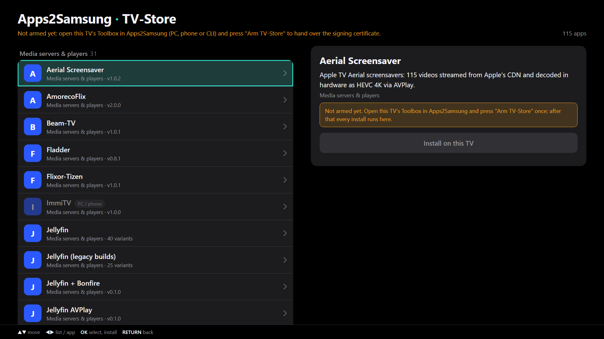

# Apps2Samsung TV-Store

Install Apps2Samsung catalog apps **natively, from the TV itself** — no PC or phone in the loop after
first setup. A Tizen web app with a background Node service that acts as the TV's own "host PC":
it connects to the set's own `sdbd`, pushes a package and runs `0 vd_appinstall`, so the app lands
in the Apps row like one installed from a laptop. Part of [Apps2Samsung#844](https://github.com/Apps2Samsung/Apps2Samsung/issues/844).



## Why this works (and why it's the only way)
A web app our certificates sign can't call `tizen.package.install` (platform privilege), and Samsung
won't issue a platform certificate to a normal account (`svdca` returns code 203 — tested). The one
installer our Public/Partner certificates reach is `sdbd` on port 26101. A `.wgt` sandbox can't open a
raw socket, but a `<tizen:service>` Node component can (proven on retail by the tessel SMB proxy).
Phase-0 probe result: **`sdbd` accepts a connection from the TV's own LAN IP, with no key auth**, once
Developer Mode's Host PC IP is set to the TV's own address.

## Layout
- `tizen-app/` — the package (`config.xml`, `index.html`, `js/app.js`, `icon.png`, `service/`).
- `tizen-app/service/sdb.js` — the SDB client (CNXN, OPEN/OKAY/WRTE/CLSE, `shell:`, `sync:` push), ported from TizenSdb.Core.
- `tizen-app/service/index.js` — loopback HTTP control plane + the install pipeline (download → sign → push → `vd_appinstall`).
- `tizen-app/service/signer.js` — the .wgt signer (XML-DSig, byte-exact with TizenSdb.Core's C# signer).
- `tizen-app/js/app.js` — the UI, and `window.A2SStore` (`status()`, `setCertificate(certs)`): what a head calls over the inspector.
- `test/` — a fake `sdbd` and an end-to-end test of connect + push + install over the real `sdb.js`.

## Status
| Piece | State |
|---|---|
| sdbd accepts a TV-side connection | proven on retail (phase 0) |
| SDB client: connect, push, `vd_appinstall` | done, proven against a fake sdbd (`node test/run.js`) |
| Catalog UI from `resolved.json` | done, in the Apps2Samsung v3 look: the bundle's embedded catalog gives names, descriptions, categories, groups and variants; manifest providers (Jellyfin builds and such) are one app each with the release's files as variants; installed apps and updates are read off the platform; install progress from the service log; Open after install. Adult packages are left out (no 18+ toggle on the TV); packages a head has to rewrite before they install (`user_settings`, TVapp / ImmiTV / Camera PiP injectors) are listed greyed with the reason |
| Service control plane (`/ping`, `/catalog`, `/install`) | done, smoke-tested |
| On-TV package signing | **done** — full W3C XML-DSig ported to Node (`service/signer.js`), output **byte-for-byte identical** to TizenSdb.Core's C# signer on the same input/keys (verified during the port); self-contained test in `test/sign.test.js` |
| Certificate hand-over from a head | done on this side: the page exposes `window.A2SStore.setCertificate(certs)` for a head to call over the web inspector (the same route the heads drive the debug agent), which posts to the service's `POST /cert`; cert PEMs may carry the chain (leaf + intermediates), embedded in KeyInfo like the C# signer does. The heads' "Arm TV-Store" button is Apps2Samsung#844 |

Install now downloads, signs (once a head has armed this TV via `A2SStore.setCertificate`), pushes and runs `vd_appinstall`. Without a certificate yet, the sub line says how to arm it and Install reports it cleanly. The one thing not exercised off-TV is the final `vd_appinstall` on real hardware.

## Release
Tag `vX.Y.Z` (matching `version` in `tizen-app/config.xml`); `release.yml` runs the tests, builds and publishes a GitHub release with `TV-Store.wgt` as its one asset. That release is what the community catalog entry points at.

## Build
A `.wgt` is just a zip of `tizen-app/` with `config.xml` at the root (no Tizen Studio needed):
```sh
scripts/build-wgt.sh        # -> dist/TV-Store.wgt
```
Install it with Apps2Samsung ("Your own package", or `apps2samsung-cli install dist/TV-Store.wgt --tv <ip>`),
which signs it with your certificate as it installs. On the TV, set Developer Mode's Host PC IP to the
TV's own IP so its sdbd accepts the service's connection.

## Test
```sh
node test/run.js            # connect + 200 KB push (verified intact) + vd_appinstall, against a fake sdbd
```
