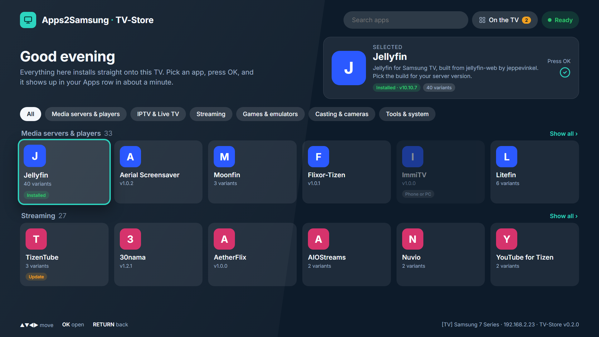
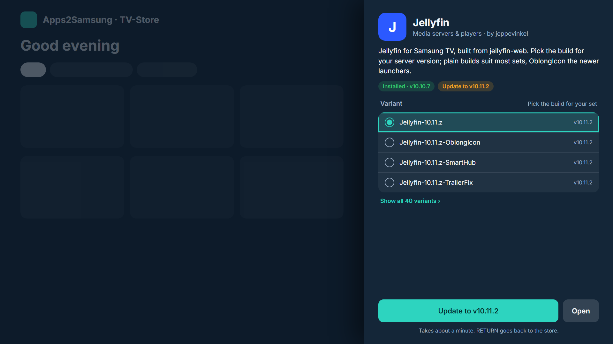
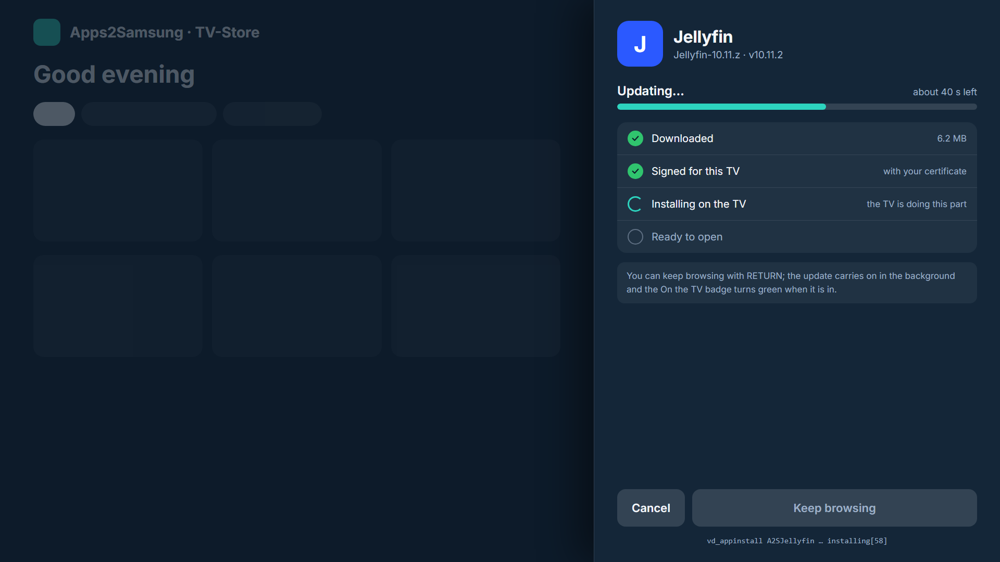
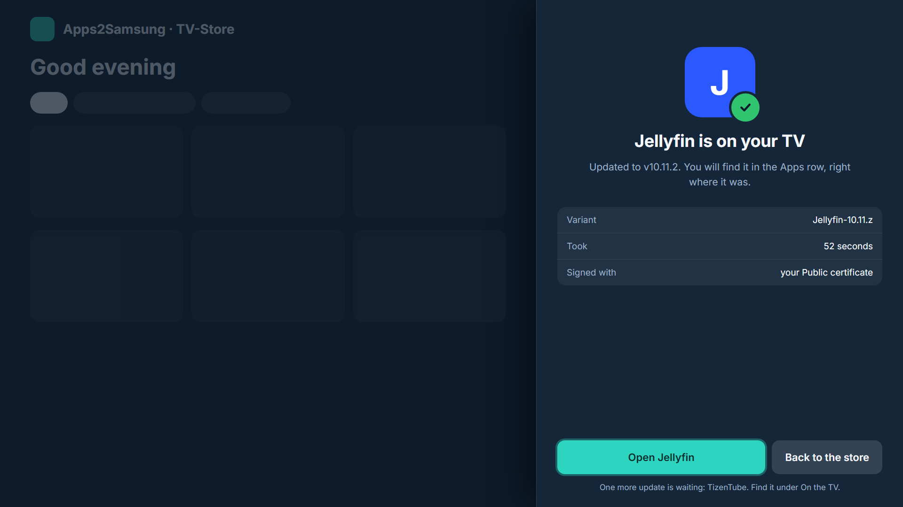
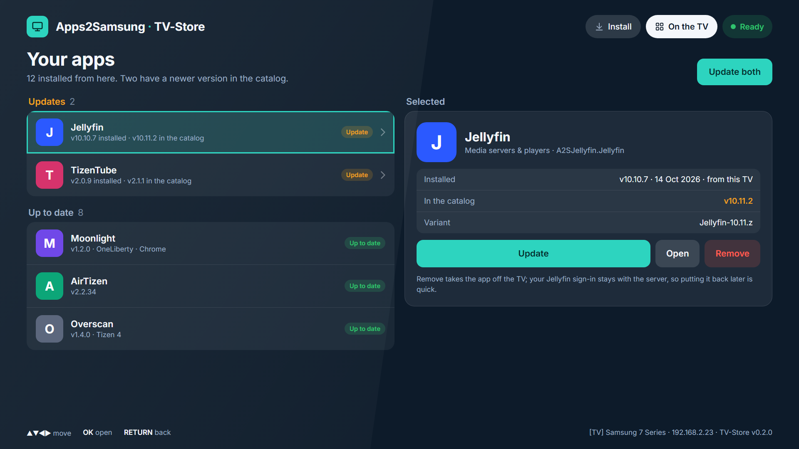
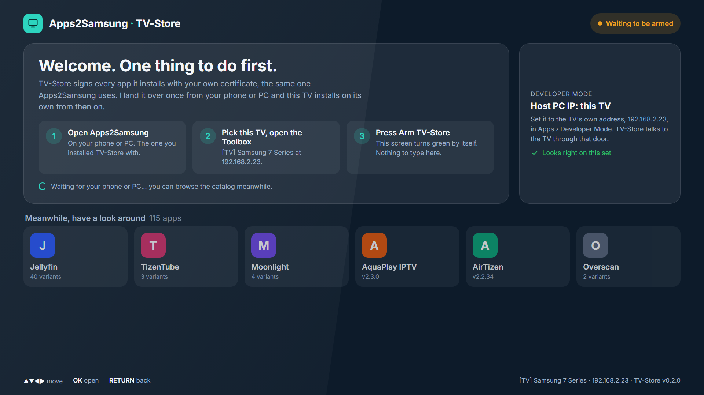

# Apps2Samsung TV-Store

The Apps2Samsung catalog on the TV itself. Browse with the remote, press OK, and the app installs
as a real Tizen package, straight into the Apps row. No PC or phone in the loop after a one-time
setup.



## How it looks

The screens below are the design the app is built towards. Dark glass, the Apps2Samsung category
colours, big tiles for a couch.

| | |
|---|---|
|  The app, its variants, one button. |  Download, sign, install: four steps you can watch or walk away from. |
|  Done, with Open right there. |  Your apps, updates first. |



## Requirements

- **Apps2Samsung 3.0 or newer** on a phone or PC, for the one-time arming. Until 3.0 is the stable
  release that means the [3.0 beta](https://github.com/Apps2Samsung/Apps2Samsung/releases); 2.x has
  no Arm TV-Store button.
- A Samsung TV in Developer Mode. Tested on Tizen 5.0 (2019) and Tizen 10 (2025); TV-Store asks for Tizen 3.0
  (2017) or newer. Every app in the catalog asks for its own Tizen version; one this TV is too old for
  shows a "Needs Tizen X" badge and does not install from here (the TV would refuse it with
  `install failed[118, -19]`, #44). Where the app has a build for older sets, the sheet lands on that one.

## Setting it up

1. Install TV-Store from Apps2Samsung like any other app, with Developer Mode's **Host PC IP** set
   to your phone or PC as usual.
2. In Apps2Samsung, open the TV's **Toolbox** and press **Arm TV-Store**. That hands every signing
   certificate on that phone or PC to the TV once. The TV-Store screen turns green by itself.
3. On the TV, set Developer Mode's **Host PC IP** to the TV's own address (TV-Store shows it), or
   to `127.0.0.1`. Either one works; `127.0.0.1` is what a rooted TV is pinned to.
4. Pick an app in TV-Store and press OK. It installs into the Apps row; no phone or PC needed from
   here on. To keep using Apps2Samsung from a phone or PC as well, turn on **Connect from Apps2Samsung** under Settings (below) instead of setting Host PC IP back.

## Apps installed from a phone or PC

Every install is signed with an author certificate, and a Samsung TV only updates an app with the
same author certificate it was installed with. Arming hands this TV every signing profile the phone
or PC holds (Public and Partner, the one older sets get, imported ones), and arming from a second
device adds its profiles to those. TV-Store remembers which profile each package took and, when the
TV answers `install failed[118, -12]` ("same id and different certificate"; `118012` on a 2018
set), signs again with the next profile until the TV takes one (#44). So an app installed from a
phone updates from TV-Store once that phone has armed the TV. Only when none of the profiles on the
TV matches does TV-Store offer to remove the old copy and install again; the app's settings and
sign-ins on the TV go with the old copy, which is why it asks first. The arming device's profiles
are listed under Settings.

## Public or Partner certificate

Apps2Samsung signs with a Public certificate unless an app needs a Partner one (partner-level rights
a Public certificate does not cover: a VPN, Samsung partner sign-in, killing other apps; or a hook
into a Samsung native package, as in SushyDev's YouTube for Tizen). A TV armed from a
device that has both profiles holds both, and TV-Store tells them apart by the Samsung CA that
issued the distributor certificate (the chain the phone or PC hands over), so a TV armed before
0.3.13 knows its levels too; Settings lists each certificate with its level (#50).

- An app the catalog marks `cert_level: partner` carries a **Partner certificate** badge and is
  signed Partner by itself. When the TV holds no Partner certificate its Install button is off and
  the sheet says how to get one: in Apps2Samsung, set the signing certificate to Partner and
  install any app once, so it creates one, then press Arm TV-Store again.
- Any other package whose manifest asks for a partner-level privilege (a VPN, Samsung partner
  sign-in, killing other apps) is signed Partner when the TV holds one, Public otherwise (those parts
  of the app then do not work). A file sent in from a browser gets the same, and its sheet says so.
  DRM playback and external storage are Public-level on a TV (Samsung lists AVPlay's DRM call as
  Public), so apps that only use those stay Public; should DRM still fail for one, **Sign with**
  below lets you pick Partner for it.
- When the TV holds both, the app sheet has **Sign with**: Automatic, Public or Partner, remembered
  per package.
- A package the TV already has keeps the certificate it was installed with, as above. Switching it
  from Public to Partner is a certificate mismatch, and the install screen offers to remove the old
  copy and install it again.

## How it works

A Samsung TV only installs sideloaded packages through its developer connection (`sdbd`), the
same door Apps2Samsung uses from a PC. TV-Store is a web app with a small background service that
acts as the TV's own PC:

1. downloads the package from the catalog and checks it against the SHA-256 the catalog gives it,
2. signs it on the TV with your certificate (the same signatures Apps2Samsung makes),
3. pushes it to the TV's own `sdbd` and installs it.

The TVs cannot check today's HTTPS certificates (their certificate store is too old), so TV-Store
trusts the content instead: the catalog (`resolved.json.signed`) is signed by the Apps2Samsung
catalog workflow and checked against the key built into TV-Store, and a package installs only when
its hash matches that catalog.

For that, Developer Mode's **Host PC IP** on the TV must be set to the TV's own address or to
`127.0.0.1`. TV-Store tries both and uses whichever the TV lets in, so a rooted TV (pinned at
`127.0.0.1`) installs too.

The screen talks to the service over HTTP on port 8077. Apps2Samsung writes the TV's own IP into
TV-Store when it installs it, because Tizen 10 may not let a page reach its service over
`127.0.0.1`; when that address stops answering, TV-Store tries the TV's current IP and loopback.
The service only answers the TV itself, except for its log.

## The log

The service keeps its log on the TV, with the previous run's next to it, so it survives a crash.
Open `http://<TV IP>:8077/log.txt` on a phone or PC in the same network, or scan the QR code under
**Settings** (also shown when the service does not start), and attach it to a bug report.
When a bug report asks for more detail, turn on **Verbose logging** in Settings first (see below).

Some catalog apps need settings written into the package before they install (a server address,
an API key). The TV cannot do that yet, so those are shown greyed with a "Phone or PC" badge and
install from Apps2Samsung on a phone or PC instead. The same goes for apps that need root, and for
any file the catalog has no hash for.

## Your own app (.wgt or .tpk)

Open `http://<TV IP>:8077/upload` on a phone or PC in the same network (Settings shows it as a QR
code), pick a `.wgt` or `.tpk` and send it. The TV keeps the file and TV-Store asks on screen:
who sent it, what the package calls itself, its hash, then **Install on this TV**, **Not now** or
**Discard**. Nothing installs until OK is pressed on the remote. The file is signed with your
certificate and installed like a catalog app, without the catalog's hash check (the file is yours).

One file waits at a time (a new one replaces it), at most 400 MB, and it must be a Tizen package
(a zip with `config.xml` or `tizen-manifest.xml` at its root). The upload page is open to the
network like the log; the install is not: only the TV-Store screen can start it, with a key the
service writes into the app's private data folder at every start, where no other app on the TV
can read it. The TV must be armed first.

## Settings

Press **▲** at the top of the list to reach **Settings**. The switches are remembered on the TV:

- **Show adult (18+) apps**: off by default. Turning it on asks "I am 18 or older" first, as the
  phone app does; those apps then carry an 18+ badge.
- **Show apps that need a PC or phone**: on by default, so nobody thinks an app is missing; turn
  it off to keep the greyed "PC / phone" apps out of the list.
- **Verbose logging**: off by default. Adds much more detail to the log: the sdb traffic, HTTP
  requests, the TV's network addresses and how long each install step took. Turn it on for a bug
  report and off again afterwards.
- **Connect from Apps2Samsung (sdb relay)**: off by default (#52). The TV's `sdbd` lets a
  connection in only from the address Developer Mode's Host PC IP names, so with Host PC IP at
  `127.0.0.1` (what TV-Store and a rooted TV want) no phone or PC can reach it. With this on,
  TV-Store's service holds port 26201 open on the TV and hands every connection to `sdbd` over
  loopback; `sdbd` then sees `127.0.0.1` and accepts, whatever the client's address. Set Host PC
  IP to `127.0.0.1` once, restart the TV, and Apps2Samsung 3.2 or newer connects to the TV from
  any phone or PC by itself (it reads the Host PC IP from the TV and dials the relay instead of
  26101). The switch says the address. While it is on, any device in your network can install
  through that port; the service also takes a client allow list (`POST /settings { relay: { allow:
  [...] } }`), not yet on this screen. This switch lives in the service, not in the page's
  settings, so `/ping` reports it (`relay: { enabled, listening, port, sessions, allow, error,
  served, failures, lastFailure }`).

  The sdb protocol cannot tell a phone or PC why its connection died, so through a relay every
  failure looks like "connection reset" (#58). The relay therefore works out what happened to each
  connection and keeps the last failure with a reason in words: `sdbd` not listening
  (`SDBD_DOWN`: Developer Mode off, or the TV needs a restart), `sdbd` taking the connection and
  closing it without a byte back (`SDBD_DROPPED`: Host PC IP is not `127.0.0.1`, or the TV was not
  restarted after setting it), `sdbd` never answering before the client gave up (`SDBD_SILENT`),
  another socket error (`SDBD_ERROR`), the allow list (`NOT_ALLOWED`) or the session cap (`BUSY`).
  It is in the log, under the switch on the Settings screen ("The last connection from 192.168.1.138
  at 10:32 failed: ..."), and any device in the network can read it at
  `http://<TV IP>:8077/relay` (`{ enabled, listening, port, sessions, served, failures,
  lastFailure: { at, client, code, reason } }`, no allow list), so Apps2Samsung can show the reason
  instead of the bare reset.

The header counts what the switches hide ("12 apps · 3 hidden").

## Pins, search by developer

- **Pin** in the app sheet pins that build of the app (the variant picked in the list) to a
  **Pinned** row at the top of the store, remembered on the TV. A pinned card shows that build's
  own state: its version, "Installed", or "Update to v…" when the catalog has a newer one; OK
  opens the sheet on that build. **Unpin** takes it off again.
- Apps whose builds share one package id (all Litefin builds are `LitefinApp`) cannot be told
  apart by the TV. TV-Store remembers which file it installed itself; for an app installed from
  a phone or PC, pin the build you have and TV-Store treats that as the installed one, on the
  On the TV page and for updates.
- The search box also matches the developer's name, and "by *developer*" in the app sheet is a
  link: OK shows every app by them (as Apps2Samsung does on the phone and PC).
- On the TV page, **▶** from an app in the list goes to its panel on the right (Details or
  Update, Open) and **◀** comes back to the list.

## Layout

- `tizen-app/`: the package: `config.xml`, `index.html`, `js/app.js`, `icon.png`, `service/`
- `tizen-app/service/index.js`: the service: catalog, certificate, install pipeline. The `.wgt` carries
  `service/` as one file, bundled by `scripts/bundle-service.js` (Tizen 10 runs services in an embedded
  Node 20 and does not start split ones)
- `tizen-app/service/sdb.js`: the SDB client (connect, push, install)
- `tizen-app/service/sdbhosts.js`: the order to try sdbd on, the TV's own IP and 127.0.0.1 (#52)
- `tizen-app/service/signer.js`: the package signer
- `tizen-app/service/catalog.js` + `catalog-key.js`: the signed catalog check and its public key
- `tizen-app/service/compat.js`: buffers that work on the TV's Node 4.4.3
- `tizen-app/service/manifest.js`: the ids, the required Tizen version and the privileges a package carries in its own manifest
- `tizen-app/service/refusal.js`: what the TV's `install failed[...]` codes mean and what TV-Store offers for each
- `tizen-app/service/certs.js`: the signing profiles handed over, their Public or Partner level, which one each package took, the order to try
- `tizen-app/js/app.js`: the UI, and `window.A2SStore`, which Apps2Samsung calls to arm the TV
- `tizen-app/js/qrcode.js`: QR codes for the log address and the Ko-fi link ([qrcode-generator](https://github.com/kazuhikoarase/qrcode-generator) 1.4.4, MIT)
- `test/`: a fake `sdbd` plus signer and transport tests
- `docs/design/`: the screens above

## Tizen 9 and 10

Since 0.3.9 TV-Store runs on 2025+ sets (Tizen 9 and 10). Those sets start a web service through
the `Service` class of the `wrt:service` module, so TV-Store starts its service that way there and
as before on older sets.

Set Host PC IP the same way as on any other TV: the TV's own address (shown in TV-Store) or
`127.0.0.1`. TV-Store tries both; only a Host PC IP pointing at a phone or PC turns the install
away, and TV-Store says so.

## Build, test, release

A `.wgt` is a zip of `tizen-app/`; no Tizen Studio needed.

```sh
scripts/build-wgt.sh        # -> dist/TV-Store.wgt
node test/run.js            # connect + push + install against a fake sdbd
node test/sign.test.js      # the signer, with a certificate chain
node --expose-gc test/stream-sign.test.js  # the file-to-file signer on a 24 MB package
node test/bundle.test.js    # the bundled service starts however the platform loads it
node test/catalog.test.js   # the signed catalog: signature, age, hashes
node test/manifest.test.js  # the ids and privileges of a .wgt / .tpk from its manifest
node test/upload.test.js    # send a file to the service, see it wait, token gate, discard
node test/certs.test.js     # the profiles handed over: merge, order per package, Public or Partner level
node test/install.test.js   # a certificate mismatch is retried with the next profile; replace
node test/certlevel.test.js # Public or Partner per install: refused up front, picked by privilege, chosen by hand
node test/sdbhosts.test.js  # the order of addresses to try sdbd on
node test/sdb-loopback.test.js  # install works whether Host PC IP is the TV's own IP or 127.0.0.1
node test/relay.test.js     # the on-TV sdb relay: a session survives the hop, allow list, cap, idle, stop; every failure told apart with a reason
node test/relay-settings.test.js  # relay settings over /settings: validation, restart only on change, status; GET /relay for the LAN
```

Install the `.wgt` with Apps2Samsung like any package. A `vX.Y.Z` tag (matching the version in
`config.xml`) publishes a GitHub release with `TV-Store.wgt` as its one asset.

## Status

| Piece | State |
|---|---|
| Install through the TV's own `sdbd` | proven on a retail set |
| Signing on the TV | done, identical output to the Apps2Samsung signer |
| Arming from Apps2Samsung (phone, PC, CLI) | done |
| The screens above | built (0.3.4); pins, developer search, your own .wgt or .tpk (0.3.10); finds itself under a renamed package id and sends you to Apps2Samsung to update it (0.3.11); Public or Partner certificate per app (0.3.13); the sdb relay switch (0.3.14); the relay's failure reasons under it (0.3.15) |
| First real install from the TV | done, 2019 Tizen 5.0 set (0.3.4) |
| Tizen 3.0 and 4.0 sets (2017, 2018) | untested |
| Tizen 10 sets (2025) | done, retail set (0.3.9) |
| Host PC IP `127.0.0.1`: TV-Store installs over loopback, Apps2Samsung through the relay | built and proven against a fake `sdbd` (0.3.14); the relay says why a connection failed and `GET /relay` tells Apps2Samsung (0.3.15, #58); not yet tried on a real set |
